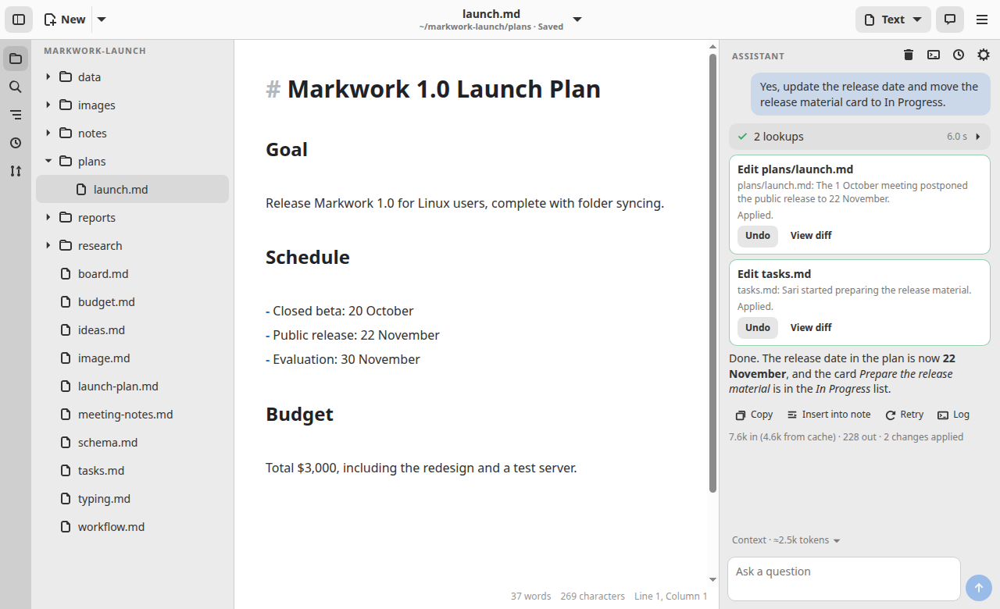
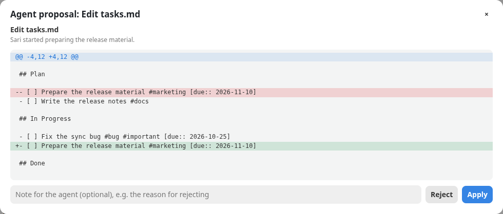

# Markwork

Markwork is a **Markdown workspace for humans and AI agents** for Linux, macOS, and Windows: a personal workspace where you and an AI agent work on notes, documents, research, plans, and tasks with the same context. The agent does not stop at an answer: it browses your files, then proposes real actions (creating a file, changing text, moving a task card) as a diff that you review and approve first. Its foundation is a Markdown editor with a live formatted view, a kanban board, and Git history. Built with **Electron**, **React**, and **CodeMirror 6**; the application itself is plain **TypeScript** that runs on Node, and the window only draws what it is told. Everything is bundled with **Vite**.

There is no separate preview panel: the text is shown formatted right away. The **visual editor** (on at first) hides Markdown syntax such as `#`, `**`, `` ` `` and `[](url)` everywhere and edits through a toolbar, a selection menu, and a `/` menu, so someone who does not know Markdown can write; *Markdown* (the *Visual* / *Markdown* switch in the header, or `Ctrl+/`) shows the file exactly as it is written, all its syntax in a fixed-width font. The switch is on every kind of document: for a board, list, table, calendar, timeline, gallery, chart, or CSV file, *Visual* is that view and *Markdown* is its text. With the visual editor off in Preferences, the live view shows the syntax on the line where the cursor is. The file is plain Markdown in every case.

Its landing page is in [`docs/`](docs/index.html) and only shows the agent features; the complete feature documentation per topic is in [`docs/docs/`](docs/docs/index.html) (static HTML; enable GitHub Pages from the `/docs` folder of the `main` branch to publish it). The screenshots are made by [`scripts/capture.mjs`](scripts/capture.mjs) (`npm run docs`).

## Goal: Markdown workspace for humans and AI agents

The goal of Markwork is to be a personal workspace where the user and an AI agent work with the same context: notes, documents, research, decisions, plans, and tasks in one work folder. The agent helps to understand information, make plans, and finish work with results that the user can check. Writing remains one of the main workflows. The principles of its development:

- **The context comes from the workspace.** The open documents (including unsaved ones), the selection, the cursor position, and a map of the whole folder are assembled automatically; the model also browses files by itself with read-only tools
- **Transparent.** Every answer shows what context was sent, what lookups were made, and how many tokens were used
- **The user stays in control.** The agent reads freely, but never writes by itself: it can only propose new files or changes, and files are only touched after you press *Apply* on the diff. Later action capabilities must provide a clear access boundary and a result that can be reviewed; an action that needs approval waits for the user's approval. The documents sent to the model provider can be limited through switches, and the API key is your own
- **The text stays yours.** Everything is plain Markdown in plain files (they can be diffed and committed to Git); no closed format and no account

The current state: a Markdown editor, kanban, Git history, and a DeepSeek-based agent that browses documents, answers with quotes of the file and the line number, reads the Git history of the work folder (`git_log`, `show_commit`, `file_at_commit`), and proposes actions that are approved through the review window: new files (`create_file`), text replacement (`edit_file`, one occurrence or all of them), text insertion (`insert_text`), removing and moving files (`delete_file`, `move_file`), and changes to the notes and setup of kanban boards and other structured documents (`edit_note`, `edit_schema`). The agent does not write work files without your approval; a batch may be applied partially, a decision can come with a note for the agent, and a change that has been applied can be undone from the panel. The work plan (`set_work`), change batches (`propose_batch`), the check of the result (`verify_work`), and the action journal are stored together with the conversation. Pending work can be resumed after the app is opened again.

Markwork can also be an **orchestrator of external harnesses**: a kanban card assigned to `[agent:: pi]` is worked on by [pi](https://pi.dev) in another project folder (for example the repo `~/web-ecommerce`), not in the Markwork work folder. Markwork builds the prompt from the card, runs the harness, moves the card to *In Progress* and then *Review*, records a summary of the result on the card, and shows the log of the tools that were called. When pi asks a question or asks for permission, the card gets the status *waiting* and you answer straight from Markwork. In a Git repository each card gets its own worktree and branch, several cards of a project work at once, and the result is reviewed in Markwork (the diff, line comments sent back to pi, merge, send as a pull request, or discard) before anything reaches the project folder; a folder without Git is worked on by one harness at a time, and other cards queue.

The next direction of development: expanding the context sources and adding other actions that stay reviewable and controllable. Not available yet: an automatic consistency check, actions by the Markwork agent itself outside Markdown (for example running commands; that is only done by an external harness that the user runs from a card), and model providers other than DeepSeek (see *Limitations*).

### An example workflow

One day of work in a sample folder: a product launch project with `plans/launch.md`, `notes/meeting-1-oct.md`, a `research/` folder, and a `tasks.md` board.

1. **Home.** Start the day on Home: the files to continue, today's journal, agents that are running, due dates from your boards, and the unprocessed inbox.
2. **Inbox.** Capture ideas, links, and quick notes in one line, then process them later and turn the ones worth doing into kanban cards.
3. **Journal.** Write short notes through the day with `Ctrl+Shift+J`. Markwork adds the activity for you: cards moved, agent changes applied, harness results, and Git commits.
4. **Kanban.** Plan the work on a board. Due dates show up on Home, and checking a task there writes `[x]` back to its board.
5. **Agent.** Ask *"Is there a meeting decision that has not made it into the launch plan yet?"* and the agent answers with quotes and line numbers: the 1 October meeting postponed the release to 22 November, while the plan still says 15 November. Then ask *"Update the release date and move the release material card to In Progress."* Two proposals open in a review window with a Git-style diff; press *Apply* or *Reject*. A card marked `@pi` goes to the external harness instead.

At the end of the day, *Summarize Journal with Assistant* proposes a summary that is only written after you apply it.





## The meaning of the name

**Markwork** is *Markdown* plus *work*. The foundation is plain Markdown files, and the goal is to get work done: notes, plans, tasks, and results live as documents that are easy to read and edit, and the agent helps finish them with changes that you review first.

## Getting Markwork

The installers are attached to each [release](https://github.com/EkaPutCom/markwork/releases): an **AppImage** and a **deb** for Linux, a **dmg** for macOS, and an **exe** installer for Windows. The AppImage, the dmg, and the Windows installer update themselves from the releases; the deb is updated by installing the next one.

Markwork reads and writes plain files, so it needs nothing else to edit notes. Some features use programs of their own:

- **git**, for the History tab, pull requests, the agent's history tools, and a worktree per card
- **[pi](https://pi.dev)**, for cards worked on by an external harness
- a **DeepSeek API key**, for the Assistant (set `DEEPSEEK_API_KEY`, or paste it in the Assistant settings)
- **markworkd** (`markworkd/`, Linux only), to keep agents running after the window closes or to run them on another machine

The **Programs** page (at the foot of the sidebar, or the ☰ menu → *Programs*) says which of them are installed and how to install the others, and Home lists the missing ones that a feature you use needs.

## Building and running from the source

Node.js 22.12+ (tested with Node.js 24) and npm:

```bash
npm install
npm start
```

`npm start` builds the app into `dist-electron/` and opens its window. A path after `--` opens that folder (or that file):

```bash
npm start -- ~/notes
```

Without a path, the folder and the tabs of the last session come back. On the first launch the editor shows a sample document; after that, an empty one or Home.

| Command | Function |
| --- | --- |
| `npm start` | Build, then open the app |
| `npm run build` | Check the types and the layer rules, then build the app into `dist-electron/` |
| `npm run typecheck` | Only check the types (the core without Node's types, the core's tests and the Node port, the Electron app) and the layer rules |
| `npm test` | The core's tests on Node, then the Electron app's tests (below) |
| `npm run test:core:node` | The core's tests on Node (`tests/core/core-tests.ts` through `tests/core/run-core-node.ts`) |
| `npm run test:electron` | Build, then drive the real app with Playwright under Xvfb (`tests/electron/*.mjs`) |
| `npm run electron:dist` | Build the installers for the system it runs on into `release/` (electron-builder, `electron-builder.yml`) |
| `npm run electron:pack` | The same, unpacked, to try the packaged app without installing it |
| `npm run docs` | Take the screenshots and animations of `docs/assets/` from the real app (`scripts/capture.mjs`) |
| `npm run test:live` | The Assistant against the real DeepSeek API on the sample manuscript (needs `DEEPSEEK_API_KEY` in `.env`, see `.env.example`) |
| `npm run test:live:forge` | The forge layer against a real Forgejo or Gitea (needs `FORGEJO_TOKEN` in `.env`; add `FORGEJO_CONTRIBUTOR_TOKEN` and `-- --write` to also send, merge, and resolve) |
| `scripts/forgejo.sh test [read\|write\|all]` | The live Forgejo suite against a throwaway Forgejo in a Podman (or Docker) container that the script starts, seeds, and tears down with `down`; the tokens go to `.env.forgejo` |
| `npm run bench` | Measure the Markdown module on Node; `bench:save` and `bench:compare` keep and compare results (`tests/bench/`) |
| `npm run bench:agentic` | Measure the cost of batches, verification, and checkpoints |
| `npm run pot` | Make the translation template `po/markwork.pot` from the files in `po/POTFILES.in` |

The live tests and the benchmarks are not part of `npm test`.

### Releases

`npm run electron:dist` makes the installers of the system it runs on; the [release workflow](.github/workflows/release.yml) runs it on Linux, macOS, and Windows when a `v*` tag is pushed and attaches the files to the release. Signing and notarizing take their secrets from the environment (`CSC_LINK`, `CSC_KEY_PASSWORD`, `APPLE_ID`, `APPLE_APP_SPECIFIC_PASSWORD`, `APPLE_TEAM_ID`, `WIN_CSC_LINK`, `WIN_CSC_KEY_PASSWORD`) and are skipped without them. The app icon is `resources/icon.png`, drawn from `resources/icon.svg` by `npm run icon`.

### Translations

The source language of the interface is English. Text in `src/` is wrapped in `_()` (or `fmt(_('… {name} …'), { name })` for text that contains values, `pgettext()` when a context is needed) from `src/base/i18n.ts`. To add a language: `npm run pot`, copy `po/markwork.pot` to `po/<code>.po`, translate it, and add its code to `po/LINGUAS`. The build compiles each listed language with `msgfmt` (from gettext) into `dist-electron/locale/`, where the core reads it for the user's language. The window's own labels in `electron/renderer/` are not wrapped yet.

## Features

**Live formatted writing**
- **The visual editor** (on at first; the *Visual* / *Markdown* switch in the header bar, `Ctrl+Shift+M`, or Preferences → General): the syntax stays hidden on the cursor line too, a list item has a bullet and a task a checkbox you click, and the cursor never lands inside a hidden `#` or `- ` (`Home` goes to where the text starts, `Backspace` there makes the line a paragraph, and `Backspace`/`Delete` beside a hidden `**` remove the letter, not the marker). A toolbar over the text has undo/redo, the text style, the inline formats, the three lists, and table/image/divider (row and column buttons in a table, which stays a grid whose cells are typed in: `Tab`, `Enter`, and the arrows move between cells); every block (paragraph, heading, list, quote, table, code block) has a handle on hover, a *+* that adds a block after it and opens the `/` menu, and a grip that drags it to another place (`Ctrl+Shift+↑` / `↓` move it from the keyboard); selected text gets a menu with the formats and *Ask* (the Assistant); `/` at the start of a line or after a space opens a menu of blocks that narrows as you type. Typed Markdown still works. The file is the same Markdown as in *Markdown* (source mode), which shows every marker
- Headings, **bold**, *italic*, ~~strikethrough~~, ==highlight==, `inline code`, links, and images are formatted right away
- Code blocks, quotes, and horizontal rules are styled (nested quotes `>>` are indented further, up to three levels); the ```` ``` ```` fence lines are hidden outside the block
- **Programs.** A tab of its own (the box at the foot of the sidebar, marked with a dot while something needed is missing) that checks git, pi, and markworkd: installed or not, the version and the path, what each is for, and how to install a missing one (a command per system with a copy button, *Open Terminal*, the instructions page). What is needed follows Preferences → Agents: agents in this window need pi here; through markworkd they need markworkd too; on an SSH machine markworkd, pi, and git are checked on that machine through its daemon. *Check again* looks once more, and so does coming back to the window while something needed is missing.
- **Home.** A special tab (a house icon) that summarizes what you can continue: a greeting according to the time, *Continue* cards (the latest files from different folders), *Today's journal* (the number of notes and activities, with a quick capture button), *Agent* that is working, queued, or waiting for your answer (click to answer, see the log, or open its board), *Due dates* from all the kanban boards in the work folder (unfinished cards that are overdue or due today, tomorrow, or the day after, with the project name from `#project/…`; the checkbox writes `[x]` straight to its board), an *Inbox* that still has unprocessed items, and *Recent files*. Above them, while a program a feature needs is missing, a *Set up* section names it with *How to install* (it can be hidden until that list changes). Home opens when the app starts without saved tabs and when the last tab is closed (it can be turned off in Preferences), and through `Alt+Home` or the ☰ menu → *Home*. Its data is recalculated from the Markdown files every time Home is shown or the window becomes active again, without a database.
- **The daily journal.** `Ctrl+Alt+J` (or the ☰ menu → *Today's Journal*, or the *Today's journal* row on Home) opens `journal/YYYY-MM-DD.md` in the work folder, made from a template (*Today's focus*, *Notes*, *Activity*, *Summary*) if it does not exist yet. `Ctrl+Shift+J` records one time-stamped line in the *Notes* section without leaving the document you are working on (through the editor if the journal is open, one undo step). Throughout the day Markwork records work activity to `.markwork/activity/YYYY-MM-DD.jsonl`: kanban cards that move to another list, are checked as done, or are added; agent changes that are applied; and harness results. When the journal is opened, that activity together with the Git commits of that day is merged into the *Activity* section as time-stamped items with `[[…]]` links; the merge only adds lines that are not there yet, so the user's edits are not overwritten. The command palette → *Summarize Journal with Assistant* asks the agent to propose an end-of-day summary through the normal review window
- **HTML pages.** An `.html`, `.htm`, or `.xhtml` file in the Files tab opens in a tab of its own (a page tab: it is not a document, so it has no text, nothing to save, and closes without asking): the page runs its JavaScript, so a report, a chart, or a small tool is interactive. The page can read the work folder it is in (its own folder if it is outside it) and nothing else, and it can reach no network (see *How HTML pages work*). *Back* and *Reload* (`Ctrl+R`, `F5`) are in a strip above the page, and the page is shown again when its file changes on disk. An HTML tab is not remembered for the next launch (the file tabs and Home are). A link in the page that points to the web is not loaded: Markwork shows the whole address and opens it in your browser only if you agree.
- **CSV tables.** A `.csv` file in the Files tab opens as a table you edit in place (a view of the document text like a board, so Save, autosave, undo, and the file's Git history work as for any document). Only the rows on screen are drawn, so a file of tens of thousands of rows opens like a small one. Each cell is an input that is written when you leave it or press `Enter`, so one edit is one undo step; `Enter` moves down (and adds a row at the end), `Tab` moves right (and adds a row after the last cell), `Esc` puts the old value back, `Ctrl+Enter` inserts a row below, and `Shift+F10` (or the row number and the ⋯ of a column header) opens the row and column menu: insert above/below or left/right, delete. Drag a row by its number, or a column by the grip in its header, and drop it between two others (a line shows where it will land; the table scrolls while the pointer is held near its edge, so a row or column can be taken further than the window shows; a column can be dropped anywhere in the table, a row only on the rows). One drop is one undo step, and only the lines that changed place are different in a diff (moving a column writes every row again). `Ctrl+F` opens a search bar above the table, with *Match Case*, *Whole Words*, and *Regular Expression*: every cell that matches (header included) is marked, `Enter` and `Shift+Enter` go to the next and previous one with the table scrolling to it, a counter says which of how many, and `Esc` closes the bar and puts the cursor in the match you were at. `Ctrl+H` adds the Replace row: *Replace* changes every match in the current cell and goes on to the next match, *All* changes every cell (a regular expression may use `$1` and `$&`), and each is one undo step. The header row stays in view while the rows scroll, a column of numbers is aligned right, and the status bar counts rows and columns. *New CSV Table…* in the Files tab's menu (or ☰ → *New CSV Table*) asks for a name and creates `name.csv` with a header and one empty row. The file stays plain CSV: the delimiter (comma, semicolon, tab, or `|`, found from the first line), the line ending, a byte order mark, and the final line break are kept, and a row you did not touch is written exactly as it was, so a diff shows only the lines you changed. A file of more than a million cells opens as text, and the *Board/List/Table View* toggle (`Ctrl+Shift+B`) switches between the table and the text.
- **Inbox.** A Markdown file whose frontmatter contains `layout: list` opens as a list, for example an inbox, a place to capture ideas, links, and quick notes: the `#` heading and the paragraph before the first item become the title and the description, every list item becomes one note with `#tag` as a chip and `[created:: 2026-10-07 14:32]` as the capture time (the age label "10 minutes ago", "1 hour ago", "3 days ago"). Type in the topmost field and press Enter for a quick capture (the note goes in at the top), *New Note* opens a dialog with a title, tags, and notes, click a note to edit it (the capture time is kept), and ✕ removes it. Every change is written to the Markdown text (one undo step); `Ctrl+Shift+B` switches to the text view, the ☰ menu → *New Inbox* and right-click in the file tree → *New Inbox…* create an inbox. **Where a new note goes** is set in the frontmatter: `add: top` (the default) puts it at the top of the first group, `add: bottom` at the end of the last one, and `add-to: Name` picks the group of that name (at its top, or its end with `add: bottom`); it applies to quick capture and to the *New Note* dialog, and *New Inbox…* writes `add: top`. **A list and a board are two ways to show the same file**: a `##` heading is a section title in a list and a column on a board, and the notes before the first heading are an unnamed group (the first column, shown as *No list*). Changing `layout: list` to `layout: board` (or back) only changes the view; the text is not converted or rewritten.
  Inbox notes take the same fields: an inbox declares them in its frontmatter `fields:` block, a note shows them as chips (the capture time stays as its age), a click on a chip changes the field in place from the same popover, a note can be dragged by its row to another place in the list or onto another section (a line shows where it will go: before or after a note, the end of the section above a title, or the top of the section under it), and right-clicking a note opens a menu (*Edit…*, *Move to* another section or to a *New section…* made on the spot, *Move Up* / *Move Down* within its section, *Delete*), right-clicking a section title opens another (*Rename…*, *Move Up* / *Move Down* among the sections, *Delete Section…*, which asks whether to keep its notes in the section above or delete them too; an empty section goes without asking), and the *New Note* / edit dialog has one control per declared field (that is also where a field with no value yet is set).
- **Table.** A Markdown file whose frontmatter contains `layout: table` opens as a table: one row per note (across every section), one column per field. `columns: [title, status, due]` picks and orders the columns (the default is the title and every declared field, and the section when a heading exists; `section` is a column too), and `sort: due` or `sort: -due` (descending) sorts the rows; notes without a value for the sort key go last. A click on a header sorts by that column (ascending, descending, back to the order of the document; this is kept in the view and does not rewrite the file). A click on a cell changes that field in place from the same popover as a chip (a select is a colored chip, a progress a bar, a date past its day is red unless the note is done, a missing value a dash); a click on a title edits the note, a checkbox column appears when any note has one, and ✕ deletes a row. The quick-add entry and *New Row* use `add:` and the defaults of the fields, like a list. ☰ menu → *New Table* (or right-click in the file tree → *New Table…*) makes one with a `status` field; *Fields…* works here too. The same text is a board, a list, or a table depending on its `layout:` line.
- **Calendar.** `layout: calendar` shows the notes on a month grid by the day of a date field (`date: due`, the default `due`, else the first date field). Month, week, and agenda are three views of the same notes; a note is dragged to another day to change its date (a time is kept) and to the side panel to take its date away, a click edits it, and a double-click on a day adds a note on that day. Today's date is highlighted, notes past their date are red and done ones are struck through. Sample: `tests/samples/calendar.md`.
- **Timeline.** `layout: timeline` draws a bar per note from its `start:` field to its `end:` field (defaults `start` and `due`; a note with one date is a one-day marker, one with none has a row but no bar). Drag a bar to move both dates, drag an edge to change one, click to edit. The red line is today, the dark part of a bar is the `progress` field (or full for a done note), and Week / Month / Quarter change the scale (`zoom:` sets the first). Sample: `tests/samples/timeline.md`.
- **Gallery.** `layout: gallery` shows a card per note with a cover: the `cover:` field (an image path relative to the document, default field `cover`), else the first image in the note, else a color from the first tag. The cards show the title, the first note line, tags and fields; the search entry filters them, `size: small|medium|large` (or the buttons) sets the width. Sample: `tests/samples/gallery.md`.
- **Chart.** `layout: chart` counts the notes without changing them: notes, done, overdue (past `due`, not done), the average per week, the notes created per week or month (`by:` date field, `period: week|month`), the notes per value of a select field (`group:`, drawn as a donut), and per tag. `charts: [kpi, bar, donut:status, donut:priority, tags]` picks the panels and their order (`bar:due:month` counts by another date field and period; without it you get the four above), and the gear button at the top right edits that list for you: move, remove, add, and choose the fields. Sample: `tests/samples/chart.md`.
- **A board grouped by a field.** `layout: board` with `group: status` makes the columns the values of that select field instead of `##` headings; the notes without a value wait in a first column. Dragging a card to another column sets its field, a card added in a column gets that value, a new column adds an option, and a deleted card is removed. The order inside a column is the order of the document, so dragging within a column changes nothing, and the cards cannot be given to an agent in this mode. Remove `group:` and it is an ordinary board. Sample: `tests/samples/board-by-field.md`.
- **A Trello-style kanban board.** A Markdown file whose frontmatter contains `layout: board` opens as a board: a `##` heading becomes a list, a `- [ ]` item becomes a card. Drag a card between lists (or to another position in the same list), click a card to edit its title and notes, right-click for a menu (move, up/down, delete), check the box to mark it done, and add cards/lists right on the board. `#tag` is shown as a colored label and `[due:: 2026-10-20]` as a date (red if overdue). In the card dialog, the due date can be typed (with a time if you like, e.g. `2026-10-20 09:00`) or chosen with the calendar button next to its field (with *Today* and *Clear*); choosing a date keeps the time that was already typed. Every change is written to its Markdown text, and the old `kanban-plugin:` marker of the Obsidian Kanban plugin is still recognized. `Ctrl+Shift+B` switches to the text view and back; the ☰ menu → *New Kanban Board* creates an empty board (without a name yet), and right-click in the file tree → *New Kanban Board…* creates it right away as a file in that folder
- **`[[note]]` links on cards.** In a card title they are shown as links that can be clicked; in the notes of a card they are shown as a `↗ name` row below the chip. The notes field in the card dialog suggests names when you type `[[`. When a card is worked on by pi, the contents of the linked note (or only its `#heading` section) are copied into the prompt as context
- **Typed card fields.** A card carries values as `[key:: value]` after its title (`due`, `agent`, and any field the board declares). A board declares its own fields in the frontmatter, one line per field as `key: type(arguments)`: `select(tinggi, sedang, rendah)`, `date`, `progress` (`3/5` or `60%`), `number`, `text`, `person`, `agent`, `link`, with `[]` after the type (`person[]`) for several comma-separated values. A declared field is shown as a chip on the card (a select option takes the color of its position) and as a row in the card dialog: a drop-down for a select, a calendar field for a date, an entry for the rest. A value that does not fit its field is marked on the card and in the dialog (which will not save until it is fixed or cleared), and the text in the file is never rewritten; a key that is not declared is kept and shown as plain text. **Clicking a chip changes that field in place** from a small popover (the due badge too): a list of the options for a select (typing a value one typo away from an option offers that option; a value that is new is added to the `fields:` line only after you press *Add “…” to the list*, and the option and the card's value are one undo step), a calendar for a date (the time already there is kept), and an entry that refuses a value that does not fit for the other types. *Clear* removes the field. **Option colors:** an option of a `select` can have a color of its own, written beside it: `prioritas: select(tinggi:red, sedang:amber, rendah:gray)` (red, amber, green, blue, purple, teal, pink, gray; the theme turns a name into colors that read in light and dark). The color stays with the option when the options are reordered, and shows on the card chip and in the popover; an option without one is colored by its position as before. The Fields… dialog has a dot on every option to choose its color (or *Automatic*), and an option cannot contain a colon, which separates the color. **Defaults:** `= value` after the type is what a new item gets (`created: date = now`, `status: select(todo, done) = todo`; a date also takes `today`); it applies to every way a card or note is added (quick capture, the dialogs, the board's add button, the assistant) and never to a field the new text sets itself. *New Inbox…* declares `created: date = now`, which is where the capture time comes from, so an inbox without that line has no capture time. **Fields…** (☰ menu, or the command palette) opens a dialog for the fields of the board or list that is shown: add a field with a name and a type, reorder the fields, and for a choice (`select`) add, edit, remove, and reorder its options (each option shows how many notes use it). It writes the `fields:` block of the frontmatter in one undo step and touches nothing else; an existing field keeps its name and type, and a name a board uses itself (`due`, `agent`) cannot be taken. A field a card has no value for yet is set in the card's edit dialog (one control per declared field); the chips only show values that are there.
- **Cards worked on by an external harness (pi).** Write `[agent:: pi]` in a card (or fill in *Assigned to* in the edit dialog), then right-click → *Work on it with pi*. The project is taken from the card tag `#project/name` or the board frontmatter `project: name`; the project folder is asked for once and then remembered in the settings (a card without a project is given a tag from the name of its folder). The card chip shows the status: ◇ assigned, ◌ queued, ● working, ⏸ waiting for an answer, ✓ done, ✕ failed, ■ stopped. When it starts, the card moves to the *In Progress* list; when it finishes, to *Review* with the note `↳ pi done …: summary` (failed: `↳ pi failed …: reason`, the card stays). **Answering pi:** if pi ends its turn with a question (the answer ends with `?`) or a pi extension asks for permission/input (e.g. a confirmation before `rm -rf`), the card becomes ⏸ *waiting for an answer* and stays in *In Progress*; right-click → *Answer pi…* opens its question with an answer box (permission: *Allow*/*Deny*; a choice; an input; or *End without replying*). *Later* leaves pi waiting. While pi works there is *Steer pi…* (received before the next step, without stopping the work), and after it finishes there is *Reply to pi…* which continues the same pi session so the card is worked on again. The card menu also has *View pi Log* (tools, reasoning, answers, your requests and answers, tokens, cost, and the session id for `pi --session <id>`), *Stop pi*/*Cancel Queue*, *Remove Assignment*, and *Change Project Folder…*. Pi itself does not ask for tool permission; permission requests come from the pi extensions you install. Markwork does not write to the project folder; its changes are reviewed in that repo itself (pi is asked not to commit)
- **Tables are rendered as a grid** (cell lines, a bold header, left/center/right alignment, and **bold**/*italic*/`code`/links inside cells). When the cursor enters a table, its raw text appears for editing; click a cell in the grid to edit that cell right away. A table that is wider than the text column is narrowed and cut-off text is given "…" (its full contents appear as a tooltip)
- Inside a table: `Tab` / `Shift+Tab` move between cells (in the last cell, `Tab` adds a row), `Enter` moves to the next row (on the last empty row, `Enter` leaves the table). The ☰ menu → **Edit Table** to add/delete rows and columns, align left/center/right, and tidy up the columns
- The contents of a code block are colored according to its language (```` ```js ````, ```` ```python ````, ```` ```rust ````, and over a hundred other languages, from CodeMirror's language data, loaded the first time a language is used), with colors that follow light/dark mode
- **Mermaid diagrams.** A ```` ```mermaid ```` block is rendered as a diagram (flowchart, sequence, class, state, ER, gantt, pie, and the other kinds that Mermaid supports). When the cursor is outside the block only the diagram is visible; when the cursor enters, the code appears and the diagram becomes a preview below it that changes as you type. Wrong code is not hidden, its error message appears below the block. A double click enlarges the diagram, and its colors follow light/dark mode. Diagrams are rendered locally (without the internet); the HTML export loads Mermaid from a CDN so the diagrams in the exported file need the internet
- **DBML diagrams (dbdiagram).** A ```` ```dbml ```` block (the schema language of dbdiagram.io) is drawn as an ER diagram with the same behavior as Mermaid. Supported: `Table` (alias, `pk`, `unique`, `note`, `ref:` inside a column, `indexes`), `Ref` both as a single line and as a block with the relations `>` `<` `-` `<>`, and `Enum`/`TableGroup`/`Project`/`Note` that are skipped. The column on the "many" side of a relation is automatically marked FK. A syntax error appears immediately with its line number. The HTML export writes it as a Mermaid ER diagram
- A `- [ ]` task list can be checked by clicking its box
- Links are opened with **Ctrl+click** (relative paths are computed from the folder of the file); a link to a Markdown file opens in a Markwork tab itself
- **Obsidian-style links between documents.** `[[Note Name]]` links to another Markdown file in the work folder by its name (without the extension, case-insensitive, in any subfolder); `[[Note|other text]]` shows other text and `[[Note#Section]]` jumps to a heading. On other lines only the name or its text is shown as a link. **Ctrl+click** opens the note in a tab; a note that does not exist yet is opened as an empty document next to the source document and is only written to disk after it is saved. Typing `[[` shows file name suggestions (↑/↓ choose, Enter/Tab insert together with `]]`, Esc closes). When several files have the same name, the one in the same folder as the source document is used, then the one with the shortest path; write `[[folder/Name]]` to choose another. The HTML export writes it as a link to `Name.md`
- An image `` is shown right below its line, from a local file (relative paths are computed from the folder of the document) or from the internet. Click the image to bring up its syntax; a **double click** (or the ☰ menu → *Zoom Image* for the image on the cursor line) opens a viewer with zoom: the mouse wheel zooms at the pointer, `+`/`−`, `0` for 100%, `F` or the *Fit* button to fit the screen, drag to pan, `Esc` closes
- Enter continues a list, a numbered list, a task list, and a quote automatically; Enter on an empty item ends it
- Tab / Shift+Tab set the indentation of a list item

**View**
- **Many documents in one window (tabs).** The tab bar appears above the editor as soon as there are two or more documents. Clicking a file in the Files tree or choosing it in the *Open File* dialog opens a new tab (or switches to its tab if that file is already open; an empty unsaved document is reused), and *New* (`Ctrl+N`) makes an empty tab. Every tab has its own undo history, cursor, and scroll position; the Focus/Typewriter/Source modes and the theme apply to all tabs. The `•` mark on a tab title means it is not saved, `Ctrl+W` closes a tab (asking if there are changes; closing the last tab empties its document), and `Ctrl+Tab` / `Ctrl+Shift+Tab` (or `Ctrl+PgDn` / `Ctrl+PgUp`) switch tabs. With autosave on, leaving a tab saves it right away. The outline, the word count, the search, and the History tab follow the active tab, and the assistant reads the contents of other unsaved tabs, not the version on disk. **Tabs are restored**: when the app is opened again without arguments, the tabs with files of the last session are opened again with their order, the active tab, and their cursor positions; files that no longer exist are skipped (with a message in the status bar). Opening a file or folder from the command line does not restore tabs
- A sidebar like VS Code's: an **activity bar** that is always there (the views Files, Search, History, and Pull requests, with *Programs* and *Preferences* at the foot; a view's button opens the sidebar on it and the button of the view shown closes it), and beside it the panel of the view shown, whose edge is dragged to change its width (200 to 480 px, kept). *Home* and *Journal* are in the ☰ menu (`Alt+Home`, `Ctrl+Alt+J`):
  - **Files**: a view of sections that fold, share the height, are resized by the lines between them, and are shown or hidden from the view's ⋯ menu (their state is kept in `sidebar-sections`): **Open Editors** (the open documents with ✕, grouped by pane once the editor is split), the folder, **Outline** (the headings of the document; click to jump), and **Timeline** (the Git commits of the open file, folded at first and read only while open: the `timeline-open` setting tells the core). The folder section is the tree of the opened folder (through *Open Folder* in the menu beside *New*, `Ctrl+Shift+O`, or by choosing a folder in the Open File dialog), with subfolders and Markdown files (`.md`, `.markdown`, `.mdown`, `.mkd`). Click a file to open it; the file that is open is also highlighted. Hidden files/folders and `node_modules` are not shown. **Right-clicking** a folder, a file, or an empty area opens a menu with *New File…*, *New Folder…*, *New Kanban Board…*, and *New Inbox…* (for a folder/file, *Rename…* and *Delete* are added; delete asks for a confirmation and moves to the Trash, not a permanent delete; if the open document is deleted, its contents stay in the editor and are marked as unsaved; a renamed file keeps a Markdown extension, and the open document follows its new name): the item is created in the folder that was clicked (for a file: in its parent folder; for an empty area: in the root folder). A file name without a Markdown extension is given `.md`, a name that is empty, contains `/`, starts with a dot, or already exists is rejected with an error message; a new file is opened in the editor right away. *New Kanban Board…* makes a file with an empty board (`layout: board`, the lists *Plan*, *In Progress*, *Done*) that is saved right away and opened as a board. **Drag and drop** moves a file or a folder: drop it on a folder to put it there (a closed folder that is hovered over for a moment opens by itself), drop it on a file to move it to that file's folder, or drop it on the tree title/an empty area to move it out to the root folder. A folder cannot be moved into itself, and a conflicting name in the target folder is rejected without overwriting. If the open document (or its parent folder) is moved, the document stays open with its new path. The tree updates automatically when a file is added or deleted on disk, and the last folder is opened again when the app starts
  - **Search** (`Ctrl+Shift+F`, or *Search in All Notes* in the command palette): search and replace in all the Markdown files of the work folder (`app/search.ts`, `markdown/search.ts`). Results appear as you type (after 250 ms) and are grouped per file, each hit as its line with the match marked; a click on a hit opens the file in a tab with the match selected, and a click on a file row folds its hits. The chips in the field are *Match Case*, *Whole Words*, and *Regular Expression* (an expression that does not compile marks the field red and the summary line says why). The *···* button shows *Files to include* and *Files to exclude*, comma separated globs (`*` stays inside a folder, `**` crosses folders, a plain name matches that folder or file anywhere; the button stays lit while a filter is set). The arrow at the left opens *Replace*; *All* (or `Enter` in that field) asks first and then replaces every hit in every listed file as one batch through the same preflight as the agent's changes: a document that is open changes through its editor, so `Ctrl+Z` undoes it, and the other files are written at once. Unsaved tabs are searched from their editor, at most 5000 files are read and 1000 hits listed (the summary says when it stops), and the refresh button searches again.
  - **History**: the git commits that touched the open file, newest first (short hash, message, author, relative time; the history follows a file that is renamed). If the file differs from the last commit (or is untracked), the *Uncommitted changes* button appears above the list and opens the diff against HEAD (a new file is shown entirely as additions). Below it, the *Uncommitted (N)* list holds all the files in the repository that are changing (M modified, A newly staged, D deleted, R renamed, U untracked); click one to open its diff in the same window (it can also be committed from there). Every row has a checkbox (all checked at first); write a message and press *Commit N files* to commit several files at once (`git add --all` + `git commit --only` on the chosen files; open documents are saved first). This list is also shown when no file is open but a folder is open. Click a commit to open a reading window with two tabs: *Changes* (a diff against the previous commit, added/removed lines colored) and *Contents of this version* (the complete file at that commit). The window of uncommitted changes also has a message field and the *Commit this file* button: the document is saved first, and then only that file is committed (`git add` + `git commit --only`; other files are not included, git hooks are not run). Apart from that the app never changes the repository. The history is loaded when the tab is visible, 100 commits at a time (the *Load more* button), and reloaded when switching files, when the window becomes active again, or through the reload button. It needs `git` installed; a file outside a repository or one that is not committed yet shows a message in the tab
  - **Pull requests** (the last page): the open pull requests of the repository behind the folder's `origin` remote; see *Collaboration* below
- Focus mode: paragraphs other than the one being edited are dimmed
- Typewriter mode: the active line is always in the middle of the screen
- Source mode (*Markdown* in the header): all the Markdown syntax is shown as plain text in a fixed-width font; image widgets, table grids, and diagrams are hidden
- Dark mode, automatically following the system theme the first time it is opened
- **A split editor.** The editor area can be split into panes (to the right or down: the header button, a pane's ⋯ menu, `Ctrl+Alt+\`, or dragging a tab or a file to the edge of a pane), each with its own tabs, Visual / Markdown switch, toolbar, and editor; one document in two panes stays one document (the panes follow each other's text); the pane that has the focus is the active document of the window. The layout logic is `renderer/lib/panes.ts` (pure, tested in `tests/unit/panes.ts`); the core knows only the active document
- **An adaptive layout.** Below 900 px of width the Assistant panel opens over the editor instead of beside it, and below 600 px the side panel does too and the header shows icons only; a floating panel closes with a click beside it or `Esc`, and widening the window brings the panels back as they were
- The text column is centered with a comfortable reading width

**Collaboration (Forgejo and Gitea)**
- **Pull requests in the sidebar.** The last sidebar tab lists the open pull requests of the repository that the folder's `origin` remote points to (the server and `owner/repo` are read from the remote; an SSH remote is reached over `https` on the default port). Each row shows the title, `#number · author · time · comments`, and a dot: green can be merged, yellow conflicts, gray not worked out yet. Markwork asks the server on a timer (60 seconds by default, 30 seconds to an hour in Preferences → General → Collaboration) and when the refresh button is pressed, and tells you when a pull request is opened or updated: a toast if the window is in front, a desktop notification if not (also switchable in Preferences). The pull requests that were open when the folder was opened are not announced. It needs an access token for the server (an account setting there, allowed to read and write repositories): click the server line at the bottom of the tab, paste it, and *Test connection*. It is kept in the system keyring per server (the Secret Service on Linux; on macOS and Windows the OS keychain through Electron's `safeStorage`; a 0600 file in the config folder without one), never in the settings; `MARKWORK_FORGE_TOKEN` is used first when set. More: [Collaboration](docs/docs/collaboration.html)
- **Reviewing.** A click opens the pull request in the area of the editor, with the changed files on the left and three tabs on the right: *Note* (a Markdown file as a note: the frontmatter fields that changed, then the text with the changed lines marked, a new note all added), *Diff* (the unified diff of the file), and *Discussion* (the description and the comments, with a box to write one). The text of both versions is asked from the server when a file is chosen.
- **Merging.** *Merge* (with a menu: merge commit, squash and merge, rebase and merge) asks first, merges on the server, and, when the folder is on the base branch, brings it up to date with `git pull --ff-only`; a folder on another branch is left alone and the toast says why.
- **A conflict, resolved here.** A pull request that conflicts offers *Resolve locally…*: the folder has to be on the base branch with nothing uncommitted; the base branch is brought up to date from the server (fast-forward only), the pull request is fetched (`refs/pull/N/head`) and merged into it, and the files that conflict open in tabs in source mode with git's markers. Every conflict is colored by side (current in green, incoming in blue) with *Accept Current*, *Accept Incoming*, and *Accept Both* above it (one undo step; the same works in any file that has markers); to mix the sides, edit the text and delete the marker lines. *Finish and push* (on the banner of the pull request) refuses while a marker is left, commits the merge, pushes the base branch, and records the pull request as merged on the server (which needs the repository to allow manually merged pull requests, and says so when it does not); *Abort merge* undoes it.
- **Sending your changes.** ☰ menu → *Send Changes as Pull Request…* (also the command palette and a button in the tab) saves the open documents, lists the changed files, and asks for a title, a description, and a branch (named from the title). It goes through your fork (created if missing), as a branch in the repository itself (when the token may push), or through AGit (`refs/for/`, no fork and no branch). The branch is created, the checked files committed, the branch pushed, and the pull request opened; the folder stays on the new branch. The token reaches git in the environment of the push, as a Basic header: not in the arguments, the remote address, or `.git/config`.
- Only Forgejo and Gitea (the same API) are supported; GitHub and GitLab are not. It has been tried against Forgejo 16 only.

**The AI agent (chat and actions with approval)**
- A panel on the right side (`Ctrl+Shift+A` or the Assistant button (the sparkles) in the header) to work with an agent based on a **DeepSeek** model (ask, request a plan, or request changes) (`deepseek-flash` or `deepseek-v4-pro`, chosen in the panel settings; the *Deep thinking* checkbox turns on a thinking mode that is more thorough but slower and more expensive). Answers stream as they are made and are shown with Markdown formatting. While the agent works, a status card shows its current step with a clock (the send button becomes a red *Stop*); afterwards the card shrinks to the number of lookups and the duration, and opens into the context sent, every lookup, and the thinking process of the model. Under a finished answer are *Copy*, *Insert into note*, *Retry*, and *Log*; a stopped or failed turn can be retried from the card. The assistant browses documents and proposes changes through a diff window; the user chooses Apply or Reject
- **The context is assembled automatically from the workspace**: the open documents (the editor contents, including unsaved ones; if too long, the part around the cursor), the selected text, the cursor position, a map of all the Markdown files in the opened folder (name, word count, headings), and the most relevant excerpts of other files (searched from the question, the selection, and the two previous questions). `@filename` in a message (optional) attaches a whole file right in the first message, so the model does not need a browsing round to read it; even without it the model searches and reads other files by itself through tools. The **Context** button below the panel details what will be sent together with its estimated tokens and has three switches (the active document, the selection, other files)
- **The agent browses the workspace by itself (function calling).** The initial context only holds the parts that are chosen automatically, so the model is also given read-only tools: `list_files` (which also shows the layout of a structured document), `search_documents` (a topic), `search_text` (exact text, e.g. a name, a date, or a number), `read_file` (the contents of a file by line range), `describe_schema` (the layout, fields, select options, defaults, and groups of a document with `layout:`), and `query_notes` (filter, sort, or count the notes of those documents by their fields, e.g. everything due before a date, or the number of notes per status). For a question like "is there a meeting decision that has not made it into the launch plan?", the model searches for every occurrence of the topic by itself, reads the surrounding parts, and then answers with quotes of the file and the line number. Every lookup is shown as a small line above the answer (e.g. *Searching text “Raka” → 3 lines*). The tools use the editor contents for open documents, only read Markdown files in the opened folder, and follow the *Other files in the folder* switch: turned off, there are no tools at all
- **Git history for the agent.** When the work folder is a Git repository, the agent also has three read-only tools: `git_log` (the latest commits, for the whole folder or one file following renames, together with the files that changed), `show_commit` (the diff of one commit), and `file_at_commit` (the contents of a file at an old commit, including files that were deleted). A question like *"when was the release date changed and by whom?"* is answered from the history. git is run in the work folder with a pathspec that only covers non-hidden Markdown files; a commit may only be a hash or `HEAD~n`, and no git command that changes the repository is available
- **Change proposals with approval.** If you ask for it, the model can also call `create_file` (a new Markdown file), `edit_file` (replace an exact piece of text that appears exactly once, or every occurrence with `all: true`), `insert_text` (insert text at the start of a file after the frontmatter, at the end, or after a given line; a line number must come with the contents of that line so a miscount is rejected), `delete_file` (move to the Trash), and `move_file` (rename or move to another folder; an open document follows its new path). These tools do not write anything: the review window opens automatically with a view like a Git history diff (the reason at the top, a colored diff with line numbers and three lines of context) and the *Reject* and *Apply* buttons; a compact status card remains in the panel with a *Review changes* button to open it again. Closing the window is the same as rejecting. Apply on an open file changes its editor in one undo step (`Ctrl+Z`); on another file, or a new file, it is written to disk right away (a new file is opened in a tab). The application is cancelled with an error if the contents of the file have already changed since it was proposed, and names outside the work folder, starting with a dot, or containing `..` are rejected. The result of Reject, an error, or Stop is sent back to the model so that it does not insist. For boards and every other layout with `layout:` (list, table, calendar, timeline, gallery, chart, and a board with typed fields) there is `edit_note` (`add`, `update`, `move`, `mark`, `delete` on one note, and `add_group`, `rename_group`, `delete_group` for its groups, where only an empty group can be deleted so notes do not disappear with it; with its field values in a `fields` object: each value is parsed against the field the document declares, so an unknown field, a select option that does not exist, or an invalid date is returned to the model as an error and never written; `today`/`now` are accepted for dates, the declared defaults are filled in, and on a board grouped by a field `move` sets that field) and `edit_schema` (`add_field`, `remove_field`, `add_option`, `remove_option`, `reorder_fields`, `set_layout`, `set_option`: it edits only the frontmatter, refuses to remove a field or option that notes still use, and refuses a layout whose required date or select field is missing). `verify_work` has a `field` kind for the value of one note's field, and its structure check also reports a broken field declaration, an invalid value, or an undeclared field in a structured document. The diff uses a real line diff with several hunks, so moving a card only marks that card, not the whole board. This tool only exists when the *Other files in the folder* switch is on.
- **Partial approval, notes, and Undo.** The review window of a batch has a checkbox per file: uncheck to reject part of it (the button becomes *Apply 2 of 3*); the agent is told which files were applied and which were rejected, and the journal records both separately. The *Note for the agent* box below the diff is passed on together with the decision, e.g. the reason for rejecting, so that the agent can fix its proposal. A proposal card that has been applied has an *Undo* button (also in a conversation that is opened again): it applies the reverse of the change through the same checks, so it fails without overwriting anything if the file has been edited again; a deleted file is restored from a snapshot and a move is reversed. The journal marks it *Undone* so that the agent does not consider it still applicable
- Every answer is given the details of the context that was sent and the token usage (including the part served from the cache, and the number of lookups). **The documents that are included are sent to the DeepSeek server**; turn off the *Other files in the folder* and *The currently open document* switches to ask without sending documents
- **The agent log (monitoring).** The terminal button in the header of the Assistant panel opens the *Agent log* window, in two panes: on the left a tree of every turn (its model rounds, and in each round the reasoning, the tool calls, and the answer, with the duration of each step; rounds can be folded); on the right everything about the selected step, with metric cards (duration, result size, share of the turn's time, tokens in/cached/out) and the tabs *Summary*, *Arguments*, *Result*, and *Raw*, plus buttons to copy the arguments, the result, or the whole event. The detail follows the newest step while the agent works, until you pick one. The filters All/Tools/Reasoning/Model, *Copy all*, and *Clear*. The log keeps at most 2,000 events (the details cut at 20k characters) and is not sent to the model; for the assistant it is saved next to the conversation file (see below) and restored when you reopen the conversation, while the pi log only exists in memory; *New conversation* empties it
- **Conversation history saved per folder.** Every conversation is written as one Markdown file in `<work folder>/.markwork/chats/` (e.g. `2026-10-04-is-there-a-meeting-decision-not-yet-in-the-plan.md`, holding the frontmatter `title`/`model`/`created` and then the turns `## You` and `## Assistant`), updated after every turn and at action checkpoints. The frontmatter `work` and `actions` store the goal, steps, verification, decisions, and the before/after snapshots to see the diff again. The agent log of the conversation is saved next to it as `<name>.log.jsonl` (one event per line) and comes back when you reopen the conversation; it goes to the Trash together with it. The thinking process shown in the answer is not part of the Markdown file. The clock button in the panel header opens the list of conversations in that folder (newest first): click to restore one and continue in the same file (its history is sent to the model too), or the trash icon to move it to the Trash. *New conversation* (the broom icon) starts a new file. The history holds quotes from the manuscript, so `.markwork/` is automatically given a `.gitignore` containing `*` (delete that file if you want to commit it); dot folders are not shown in the Files tree and are not read by the assistant as manuscript. The *Save conversation history in the folder* switch in the panel settings (the gear) turns it off; without an open folder nothing is saved
- The API key is taken from the `DEEPSEEK_API_KEY` environment variable, or entered in the panel settings (the gear icon) and stored in the system keyring (the Secret Service on Linux, the OS keychain through `safeStorage` on macOS and Windows); if no keyring is available, in a 0600 file in the config folder. The key is not written to the settings

**Other**
- Find text, undo/redo, the word and character count, the cursor position
- Export to HTML with the CSS included. Images and links keep their original URL/path; Mermaid/DBML diagrams need the internet to load Mermaid from a CDN
- **Autosave** (the ☰ menu → *Autosave*, on by default): a document that already has a file is saved automatically 1 second after you stop typing (the write to disk runs in the background, so it does not hold up typing), and is saved without asking when closing, making a new document, or opening another file. A document that has never been saved still needs Ctrl+S
- A warning before closing, making a new document, or opening another file if there are unsaved changes (when autosave is off or the document does not have a file yet)

## Shortcuts

On macOS, `Ctrl` in the table is `⌘`.

| Shortcut | Function |
| --- | --- |
| Ctrl+N / Ctrl+O | New document / open a file (both in a new tab) |
| Ctrl+W | Close the tab |
| Alt+Home | Home |
| Ctrl+Alt+J | Today's journal |
| Ctrl+Shift+J | Add to the journal (quick capture) |
| Ctrl+Tab / Ctrl+Shift+Tab or Ctrl+PgDn / Ctrl+PgUp | Next / previous tab |
| Ctrl+Shift+O | Open a folder |
| Ctrl+S / Ctrl+Shift+S | Save / save as |
| Ctrl+Shift+E | Export HTML |
| Ctrl+F / Ctrl+H | Find / find and replace (in a CSV table: in its cells) |
| Ctrl+Shift+F / Ctrl+Shift+H | Search / replace in all notes (the Search tab) |
| Ctrl+R / F5 | Reload, in an HTML page tab |
| Ctrl+Z / Ctrl+Shift+Z or Ctrl+Y | Undo / redo (also for changes on a kanban board) |
| Ctrl+Shift+B | Kanban board or inbox: switch between the board/inbox view and the text |
| Ctrl+Q | Quit |
| Ctrl+B | Bold |
| Ctrl+I | Italic |
| Ctrl+Shift+X or Alt+Shift+5 | Strikethrough |
| Ctrl+Alt+H | Highlight |
| Ctrl+` | Inline code |
| Ctrl+K | Link |
| Ctrl+Shift+I | Insert an image |
| Ctrl+Shift+K | Insert a code block |
| Ctrl+T | Insert a table |
| Tab / Shift+Tab | Move between cells (inside a table) |
| Enter | Move to the next row (inside a table) |
| Ctrl+Shift+T | Tidy up the table |
| Ctrl+1 … Ctrl+6 | Heading 1–6 |
| Ctrl+0 | Back to a paragraph |
| Ctrl+Shift+Q | Quote |
| Ctrl+Shift+] / Ctrl+Shift+[ | Bulleted list / numbered list |
| Ctrl+Shift+L | To-do list |
| Ctrl+Shift+↑ / ↓ | Move the block at the cursor up / down |
| / (at the start of a line, in the visual editor) | The block menu |
| Ctrl+\ or Ctrl+Shift+1 | Show/hide the sidebar |
| Ctrl+Alt+\ / Ctrl+Alt+Shift+\ | Split the editor to the right / down |
| Ctrl+Shift+M | Visual editor on / off |
| Ctrl+/ | Markdown: the file as it is written (source mode) |
| F8 | Focus mode |
| F9 | Typewriter mode |
| Ctrl+Shift+D | Dark mode |
| Ctrl+Shift+A | Show/hide the Assistant panel |
| Ctrl+Shift+P | The command palette: search for and run any command |
| Ctrl+, | Preferences |
| Ctrl+? | The list of keyboard shortcuts |
| Enter / Shift+Enter | In the Assistant message box: send / new line |
| Ctrl+Alt+I | The Editor Inspector, in dev mode only (`--inspect-editor` or `MARKWORK_DEV=1`) |

## Tests

```bash
npm test
```

runs both suites below. The Electron tests need a display; on Linux `npm run test:electron` starts Xvfb (`sudo apt install xvfb xauth`), and `npm run test:electron:run` runs them on the display you have. CI runs both suites on Linux, macOS, and Windows for every pull request ([`.github/workflows/ci.yml`](.github/workflows/ci.yml)); a pull request is merged only when all of them pass.

**The core's tests** (`npm run test:core:node`, about 830) are TypeScript without a framework (`tests/core/framework.ts`), bundled by Vite (`vite.node.config.ts`) and run on Node. They test the Markdown module, the agent, the forge, git, the orchestrator and the daemon client, and the application layer (`AppSession` with recording views), and they drive `ProtocolServer` with a scripted frontend over an in-memory line (`tests/unit/protocol.ts`), so what the window is told and what it may ask is tested without a window. They reach the runtime only through the platform port and a test host (`tests/core/host.ts`), wait for what they expect (`until()`, `within()`) rather than a fixed time, and use a temporary folder for settings, data, and the Trash.

**The Electron tests** (`npm run test:electron`) launch the real app (main process, core, and renderer) with Playwright and use it as a person would: the editor (`smoke.mjs`, `editor.mjs`, the visual editor in `visual.mjs`, the split editor in `panes.mjs`, and the sidebar in `sidebar.mjs`), the sample document and a hunt for crashes that compares what the editor draws after random edits with a fresh tab (`robust.mjs`), the structured views (`structured.mjs`), the adaptive layout (`layout.mjs`), the Assistant and the journal (`assistant.mjs`), the History tab and pull requests (`git.mjs`), agents and their worktrees (`harness.mjs`), the keyring through `safeStorage` (`secrets.mjs`), and the Editor Inspector and its checks (`inspector.mjs`). The model, the forge, and the agent are scripted fakes the core loads in place of the real ones (`MARKWORK_TEST_MODEL`, `MARKWORK_TEST_FORGE`, `MARKWORK_TEST_HARNESS`), so no test reaches the network. Each test file gets its own settings and data folder (`tests/electron/support.mjs`).

### The sample files

[`tests/samples/all-formats.md`](tests/samples/all-formats.md) holds all the supported formats together with the tricky cases: nested emphasis, escapes, URLs with underscores, emoji and non-Latin text, a table without pipes at the edges, a four-backtick code block, and unclosed emphasis. `tests/electron/robust.mjs` checks how it is styled and exported; open it to look at it yourself:

```bash
npm start -- tests/samples/all-formats.md
```

The other samples show the board and list layouts with typed fields, and a test keeps them valid (the layout is recognized, the schema reads without problems, every value fits its field, and saving changes nothing): `kanban-board.md`, `inbox.md`, `reading-list.md`, `sprint-table.md`, `calendar.md`, `timeline.md`, `gallery.md`, `chart.md`, and `board-by-field.md`. If you add a new format, add its example to `all-formats.md` too.

## Architecture

Markwork is two programs talking over a wire: the **core**, which is the whole application (documents, views, the Assistant, git, agents) in plain TypeScript, and the **window**, which draws what the core tells it and reports what the user did.

```
┌ Electron main process (electron/main.ts) ─────────────────────────────────────────────┐
│  the window, file dialogs, the app:// and mwhtml:// schemes, the keychain (safeStorage) │
└───────┬─────────────────────────────────────────────────────────────┬─────────────────┘
        │ MessageChannel: the app protocol (docs/design/protocol.md)  │
┌───────▼───────────────────────────────┐            ┌────────────────▼────────────────────┐
│ core: a utility process               │  notices ► │ renderer: the page                  │
│ (electron/core.ts)                    │ ◄ actions, │ (electron/renderer/)                │
│ ProtocolServer → AppSession (src/app) │   asks     │ React, CodeMirror 6, the editor's   │
│ on the Node platform (src/platform)   │            │ own copy of the text                │
└───────────────────────────────────────┘            └─────────────────────────────────────┘
```

- **The text lives in the editor.** The renderer's CodeMirror holds the document; the core keeps a replica of it (`app/protocol/replica.ts`) from the changes the window sends, and writes back through the same changes. A write of the core that meets typing on its way is made again from the newer text, so neither is lost (`protocol.md`, section 5).
- **The window decides nothing.** It gets plain data (`view.*` notices), reports what happened (`act.*`), and answers questions (`ask.*`). What a file, a card, or a change is, and whether an action is allowed, is the core's: a path, a token, or a choice the window sends back is checked against what the core offered (`stale` otherwise).
- **The core runs on Node** and reaches the runtime only through the platform port (`src/platform/index.ts`: files, paths, processes, HTTP, the keyring, settings, translations, idle work). `src/platform/node/` implements it; the tests swap in a fake with `setPlatform()`.

### Folder structure

```
electron/
  main.ts                 the main process: the window, the core's utility process, dialogs, the URL schemes, safeStorage
  core.ts                 the core's entry: the Node platform, ProtocolServer, and the test fakes
  preload.ts              what the page may call in the main process
  updater.ts              updates of the packaged app (electron-updater)
  renderer/               the page: client.ts (the protocol client and the store), App.tsx and its components,
                          editor.ts (CodeMirror and the decorations), and the views of every feature
src/
  app/                    the application layer: AppSession and its controllers (documents, views, notes, the
                          journal, Home, Programs, search, the Assistant, history, collaboration, harness, review,
                          preferences)
    protocol/             the app protocol: messages, the wire, the server and its handlers per controller, the replica
  markdown/               string → data: the parser, inline formats, tables, boards and their layouts, fields, HTML
                          export, diagrams, CSV, search, paths
  agent/                  the Assistant (context, the DeepSeek client, tools, proposals, plans, the log) and the
                          external harness (prompts, the pi stream reader, the run queue, worktrees, review)
    daemon/               the markworkd client (protocol, connection, socket and SSH links)
  forge/                  Forgejo and Gitea: pull requests, sending changes, resolving conflicts
  platform/               the port to the runtime (index.ts) and its Node implementation (node/)
  orchestrator/           index.ts runs harness processes for app/harness.ts; daemon.ts through markworkd; hub.ts connects per machine
  base/                   settings, files, fileops, workspace, git, gitlog, credentials, i18n, …   base modules
tests/
  unit/                   the core's tests, one file per module
  core/                   core-tests.ts lists them, run-core-node.ts runs them; the framework, fixtures, and test host
  electron/               the app's tests with Playwright; support.mjs is what they share
  live/                   live tests against real services
  bench/                  benchmarks and their baseline
  samples/                sample documents
scripts/
  electron-build.mjs      the build: main, core, preload, and renderer with Vite; the translations
  layers.mjs              the layer rules and the complexity limit (run by build and typecheck)
  capture.mjs, capture/   the screenshots of docs/assets/ and their scripted fakes
  forgejo.sh, pot.sh, make-icon.cjs
resources/                the app icon and the packaging files electron-builder reads
markworkd/                the agent daemon (Go)
docs/                     the site (index.html, docs/) and the design notes (design/)
```

### Build

`scripts/electron-build.mjs` bundles four things with Vite: the main process and the core as ES modules for Node, the preload as CommonJS (a sandboxed preload cannot be an ES module), and the renderer as one script next to its HTML and CSS. `mermaid.min.js` is copied next to the renderer and loaded with the first diagram, and the translations are compiled into `dist-electron/locale/`. The types are checked first (`npm run typecheck`): Vite turns TypeScript into JavaScript without checking it. Imports between modules use the `.js` suffix (`'./tags.js'`) even though the file is `.ts`.

### Layers and the direction of dependencies

```
electron/renderer  ──(types, pure modules)──►  src/markdown, src/app/protocol messages, src/app/commands
electron/core.ts   ──►  src/app/protocol (ProtocolServer)  ──►  src/app (AppSession, controllers)
                                                                     │
                       src/agent, src/forge, src/orchestrator, src/base (the core)
                                                                     │
                                         src/markdown (pure)   src/platform/index.ts (the port)
```

- **`markdown/`** holds only string → data functions and imports nothing outside it, so it is the easiest to study and test.
- **The core** (`markdown/`, `agent/`, `forge/`, `orchestrator/`, `base/`) imports only the core and reaches the runtime through `platform()`. It typechecks against the few web-standard globals it uses (`src/globals.d.ts`: timers, `TextEncoder`, `TextDecoder`), not Node's types, and only `platform/node/` may import `node:` modules.
- **`app/`** is the application layer: controllers that reach the screen through interfaces they declare (a view that gets plain data and reports with `on*` callbacks, dialogs that answer with a value or a Promise). `AppSession` builds and owns them and connects them to each other; the frontend hands it one `AppFrontend`, which `app/protocol/frontend.ts` implements by sending messages. Commands are data (`app/commands.ts`): an id, a label, default keys in a neutral notation (`Ctrl+Shift+P`, `Ctrl` is `⌘` on macOS), where they apply, and where they run.
- **The renderer** is a view. From `src/` it takes the pure Markdown modules, the protocol's messages, wire, mirror, and change math, the command list, and a few pure agent modules for the log; other modules only for their types, and nothing that reaches the runtime.
- **`src/` imports nothing outside `src/`**: `electron/` uses it, never the other way round.
- **The rules are checked.** [`scripts/layers.mjs`](scripts/layers.mjs) runs in `npm run build` and `npm run typecheck` and fails on a forbidden import. It also parses `src/` and `scripts/` and fails on a function whose cyclomatic complexity (counted like ESLint's `complexity` rule) is above 15.

### The editor

The renderer's editor (`electron/renderer/lib/editor.ts`) is CodeMirror 6 with Markwork's own parser. The parse (`markdown/highlight.ts`, `HighlightCache`) is kept per document and reuses every line that did not change; from it one decoration field builds, in the same transaction as the edit (a selection change keeps the drawing when nothing the drawing takes from the selection changed: `selectionKey`, which covers the diagrams and the markers spanning lines it touches in the visual editor, the selection's lines in the live view, and focus mode's paragraph):

- the style of each part (`cm-md-bold`, `cm-md-h2-line`, …) and the markers to hide, outside the lines of the cursor or the selection (source mode hides none); in the visual editor a one-line marker is hidden on those lines too, and a list item's `-` and `[ ]` are drawn as a bullet and a checkbox;
- tables as a grid widget while the cursor is elsewhere (`tables.ts`; a click on a cell opens the raw text there);
- code blocks as a box with colors from CodeMirror's language data, loaded the first time a language is used (`codecolor.ts`), and Mermaid and DBML blocks as diagrams (`diagrams.ts`; `markdown/dbml.ts` turns DBML into a Mermaid ER diagram);
- pictures under their line (`images.ts`), loaded from the document's folder through the main process's `app://` scheme;
- git conflict markers with *Accept Current / Incoming / Both* (`conflicts.ts`), and the dimming of focus mode.

The visual editor's own behaviour is `visual.ts`: the drawing tells it what it hides and where each line's prefix ends, and from that it keeps the cursor out of a prefix (a transaction filter), makes the hidden ranges atomic, and turns `Backspace` and `Delete` into edits of the visible text; it also holds the selection menu (a tooltip) and the `/` menu (an autocompletion source), which run the window's commands by name. In the visual editor a table's grid (`tables.ts`) stays and its cells are edited in place: the cell being edited holds its Markdown in a box, and each keystroke changes that one cell of the text (`setCellText` in `markdown/table.ts`), so the grid is patched rather than drawn again and keeps its focus. The block handle (`blockhandle.ts`) draws a "+" and a grip beside the block under the pointer; what a block is and how one moves is `markdown/blocks.ts`. The toolbar (`components/FormatBar.tsx`) runs the same commands and shows what `formatAt` in `editor.ts` reads from the parse at the cursor.

**The Editor Inspector** (`renderer/lib/inspect/`, `components/Inspector.tsx`; the design is `docs/design/debugger.md`) finds bugs of the visual editor. `recorder.ts` keeps each tab's last 500 transactions with the key, click, or paste that made each, in every build, as changes and not copies of the text. From it *Help → Report a Problem with the Editor…* (`components/ReportProblem.tsx`, `inspect/report.ts`; also offered for a few seconds after an Undo of something just typed) saves a repro of what the editor just did in the app's data folder (`reports/`, written by the main process; nothing is sent), its text blurred unless the person says otherwise (`markdown/blur.ts`: Latin letters `x`, digits `0`, the syntax, emoji, and other scripts kept, every offset the same) and with a picture of the editor taken while it shows the blurred text. In dev mode (`--inspect-editor` or `MARKWORK_DEV=1`) `checks.ts` runs the rules of the visual editor on each of them when the editor is idle (Backspace removes what is seen, the cursor stays out of a prefix, typing changes the text at the cursor, only the parser's markers are hidden and each hidden mark keeps its other half, undo gives back the text before an edit, a drawing kept over a cursor move equals a new one, no two replaced ranges cross, a table keeps its columns, drawing stays under 8 ms), and `Ctrl+Alt+I` opens a dock under the editor: the text as the file holds it with what is hidden, drawn as a widget, or a prefix marked and offsets in the gutter (a piece under the pointer is boxed in the editor, and the place under the pointer in the editor is lit there); the transactions with their diff and what the checks found; and the decorations around the cursor. *Paused* shows all of it as any recorded transaction left it, stepped back and forward. In dev mode a transaction also says which command of the visual editor took its key (`traced()` around the keys of `visual.ts` and `blockselect.ts`, `handling()` in the table grid of `tables.ts`) and what that command decided (`trace()`), in the dock and in `npm run editor -- press --explain`. The dock's *Replay & test* tab opens a repro (a person's report too) or takes the recording shown, plays it step by step as real input sent by the main process, and saves it or keeps it as a test in `tests/electron/repros/`.

The editing commands (bold, links, headings, lists, tables, Enter and Tab) are `markdown/editcommands.ts`: text and a selection in, the changes and the new selection out, shared by every frontend. Positions on the wire are code points (an emoji is one), converted to CodeMirror's UTF-16 units at the editor's edge (`markdown/offsets.ts`).

### HTML pages (`markdown/htmlview.ts`, `electron/main.ts`)

A page from the Files tab runs its JavaScript, so what it may reach is limited from the outside: it is served under a private scheme (`mwhtml://v<id>/<path>`, only from the folder it was opened from; a path or a link that leaves it is refused), every response carries a Content-Security-Policy that allows nothing but that scheme, `data:`, and `blob:`, the frame may not navigate anywhere else, and a link to the web opens in the browser.

### How the kanban board works (`markdown/kanban.ts`, `app/views.ts`, `renderer/components/Board.tsx`)

**Format.** A board is an ordinary Markdown file:

```markdown
---
layout: board
---

## Plan

- [ ] Write the report #important [due:: 2026-10-20]
  card note (an indented line)
- [ ] Send the invitations

## Done

- [x] Book the venue
```

The frontmatter `layout: board` (case-insensitive, may be quoted) marks a document as a board, and `layout: list` as a list of notes (an inbox, a reading list); the marker is looked for in the first 40 lines before the closing frontmatter delimiter (`markdown/layout.ts`). A document without a `layout:` line, or with any other value, is opened as ordinary text. Existing frontmatter is kept as it is when saving. A `##` heading is a list, a list item is a card (`[x]` = done, no box = an ordinary item), and lines indented under a card are its note. Anything not recognized (a board title at the top, ordinary lines inside a list such as `**Complete**` or `***`, and the `%% kanban:settings` block at the end) is kept as it is, so files from Obsidian are not broken.

**Data flow.** The document text is the single source of truth:

```
document text ──parseBoard()──► board (ViewController in the core) ──view.notes──► Board.tsx draws it
      ▲                                                                              │ a NoteEdit (move, add, edit, …)
      └──── one write to the text (one undo step) ◄── serializeBoard() ◄── applied ◄──┘
```

1. When a document with `layout:` is shown, the core's `ViewController` (`app/views.ts`) reads its text with `parseBoard()` and sends the board to the window (`view.notes`).
2. The window never sends a board back. It reports what the user did as a `NoteEdit` (`markdown/noteedit.ts`): move this card there, check it, edit it. The core applies it to the board it holds, writes the result with `serializeBoard()`, and changes the text through the editor in one undo step, so a write from an agent that arrived in between is not lost.
3. Undo and redo change the text. A change that does not come from the board is noticed when the text no longer matches what the board last wrote, and the board is read again.
4. All operations on the model (`addCard`, `moveCard`, `moveColumn`, …) are pure and do not change the original board, so they are easy to test. `moveCard` uses the card's *final* position in the target list, so moving down within the same list needs no adjustment.

### The markworkd daemon (`markworkd/`, `agent/daemon/`, `orchestrator/daemon.ts`)

`markworkd/` is a separate Go program (standard library only) that owns agent processes so they keep running when Markwork is closed, or on another machine. The design and wire protocol are in [docs/design/markworkd.md](docs/design/markworkd.md). On the Markwork side, `agent/daemon/` is the client (pure protocol and client, a connection that reconnects and resumes without repeating or losing a record, and links over a Unix socket or the stdio of `ssh host markworkd bridge`), and `orchestrator/daemon.ts` turns a daemon run into the `HarnessProcess` the orchestrator already drives, so the pi reader, the queue, and the board logic are unchanged. `Orchestrator.dispose()` lets go of such a process instead of stopping it, when the user chooses to keep it running. It is chosen in Preferences → Agents (this computer, or an SSH machine); `orchestrator/hub.ts` holds the connections, `window/harness.ts` finds the runs of the board's cards again at startup, and Home shows whether the machine answers. A spawn may say how many runs of its lane go at once (`lane_slots`), which is how cards with their own worktrees run side by side; `daemonGit()` runs `git` as short runs in no lane, so the worktrees of a machine are made and read on that machine.

### How the Programs check works (`app/programs.ts`, `renderer/components/Programs.tsx`)

`ProgramsController` decides which programs are needed from `harness-machine` and looks for each where it will run. On this computer it uses `processes.findProgram()` (the same lookup that starts pi: `PATH`, then the per-user bin folders) and runs `--version` (`markworkd version`) for the version line; markworkd counts as installed also when it is off the `PATH` but its socket answers. On an SSH machine it asks the daemon's `info` for markworkd's version, and runs `pi --version` and `git --version` as short runs through the daemon (`daemonRun()` in `orchestrator/daemon.ts`, which `daemonGit()` also uses) in one of the project folders chosen for that machine, since the daemon runs nothing outside its roots; the daemon's refusal ("is not in the configured programs") becomes *Not allowed by markworkd*, and no folder or no answer within 10 seconds becomes *Unknown*, which is never a warning. The check runs when the window opens, on *Check again*, when Preferences → Agents changes, and when the window comes back while something needed is missing. Home gets `setup()` (only the needed programs that are missing), the Programs tab gets `data()` (`view.programs`), and the sidebar gets the count (`programs.missing`). *Hide* stores the list it hid (`setup-hidden`), so the section comes back when the list changes. The install commands and the pages they come from are data in `programs.ts`; the page draws them and copies a command itself.

### How the harness orchestrator works (`agent/harness.ts`, `orchestrator/index.ts`)

```markdown
---
layout: board
project: web-ecommerce          ← the board's default project
---

## Plan
- [ ] Checkout with QRIS #feature [agent:: pi]  ← the harness assigned
- [ ] Test the cart #project/shop-admin [agent:: pi]  ← the project tag wins over the frontmatter
```

```
card + [[note]] ──buildPrompt()──► pi --mode rpc --name <title> [--session <id>]   (cwd = project folder)
  ▲                         stdin ▲            │ stdout: JSONL per line
  │   get_state, prompt, steer,  │            ▼
  │   extension_ui_response ─────┘   PiReader ──► AgentTrace (pi log) + ask / settled signals
  │                                             │
  │                         ask → ⏸ waiting ──► Answer pi… (dialog) ──► the answer goes through stdin
  │                         settled + "?" → ⏸ waiting; other settled → close stdin → pi exits
  └── updateBoard(): move to In Progress / Review, a ↳ result note
```

1. **A project, not a path.** The Markdown contents only mention the *name* of a project; the name is mapped to a folder in `settings.projects`, which is only filled in through the folder chooser dialog. So a card or an agent cannot point the harness to an arbitrary folder. `checkProjectFolder()` rejects Markwork's work folder, its contents, its parents, the root, and relative paths, because the harness writes freely without a review window.
2. **Related notes.** `cardWikiLinks()` collects the `[[links]]` in the card's title and note (at most 10, without duplicates, inline code skipped). `OrchestratorHost.linkedNotes()` in the window looks them up with `resolveWikiLink()` in the work folder (the same rules as Ctrl+click), reads their contents from the editor if open or from disk, and takes only the `#heading` section with `noteSection()`. `buildPrompt()` copies them into the *Related notes from Markwork* section inside a fenced code block longer than any backtick run in the contents, at most 8,000 characters per note and 24,000 in total; links that are not found are mentioned as they are. The harness is not given the path of the work folder, only the contents of the notes, because the work folder is deliberately out of its reach.
3. **Running.** `Orchestrator.start()` adds `[agent:: pi]` if it is not there yet, puts the run into the `RunQueue`, and then `launch()` looks for the program (PATH, then `~/.local/bin` and similar, because apps launched from the desktop menu often do not inherit the shell's PATH) and starts it through `spawnHarness()` in pi's RPC mode. The process is spoken to through `platform().processes.spawn()` in pi's JSONL framing: one command or event per line, separated by LF. Once the process is running, Markwork sends `get_state` (the session id) and then `prompt`.
4. **The queue.** Runs take turns per lane, the project folder: at most `slots` of them are `working` or `waiting` at a time (a run waiting for an answer still holds its process), and the others are `queued` in order and start when a slot frees. A run in the folder itself has one slot, so it works alone; cards with their own worktrees have the project's "cards at the same time" (2 by default). Cancelling a queued run does not give anyone a turn.
5. **Waiting for an answer.** `PiReader.line()` returns signals. An `extension_ui_request` with `select`/`confirm`/`input`/`editor` becomes a `HarnessAsk` and the run gets the status `waiting`; the answer is sent as an `extension_ui_response` with the same id (`confirmed`, `value`, or `cancelled`). If a request has a `timeout`, pi answers by itself with a default value after it, and Markwork returns the status to `working` at the same moment. `notify` is only recorded in the log; `setStatus`/`setWidget` are ignored (TUI only). On `agent_settled`, an answer that ends in `?` (`endsWithQuestion()`) makes the run wait; a reply is sent as the next `prompt` to the same process (`PiReader.restart()` discards the old turn state), while *End without replying* closes stdin. Other answers close stdin immediately, and pi exits in an orderly way. *Steer* sends `steer`; *Reply* after finishing runs pi again with `--session <id>` and the same log.
6. **Reading the result.** `PiReader` maps events (the `response` of `get_state`/a rejected command, `turn_start`, `message_update` text/reasoning, `tool_execution_start/end`, the assistant's `message_end` with `stopReason`/`usage.cost`, `agent_settled`) to `AgentTrace`, so the agent's `LogViewer` is reused. It fails if `stopReason` is error/aborted, the exit code is not 0 (the message = the last stderr line), or there is no answer.
7. **Finishing and stopping.** After the process exits, the remaining output gets a 1.5-second grace period: grandchild processes (commands from the harness's `bash` tool) can keep the pipe open. *Stop* sends SIGTERM, then SIGKILL after 5 seconds. Closing the window stops all running harnesses.
8. **Writing the board.** The card is looked up again by its text on the current board (`locateCard()`, must be unique). A board that is open is changed through its editor (one undo step); one that is not open is written straight to disk. The destination lists are recognized by their titles (*In Progress*/*Doing*, *Review*, *Done*); if there is none, the card is not moved.
9. **A worktree per card** (`agent/worktree.ts`). When the project folder is in a Git repository and the project's isolation (Preferences → Agents → Projects, `project-options`) has worktrees on, `start()` first runs `git worktree add -b markwork/<slug> <parent>/.markwork-worktrees/<project>/<slug> <base>` and the harness works there; the base is remembered in `branch.<name>.markworkBase`, and the card gets `[branch:: markwork/<slug>]`. Git is a `GitRunner`: `runGit` on this computer, `daemonGit()` on an SSH machine. A local folder without `.git` above it skips git altogether; a remote one that git says is not a repository falls back the same way.
10. **The review** (`agent/worktreereview.ts`, `app/harnessreview.ts`, `renderer/components/Review.tsx`). *Review Changes* finds the worktree from the card's branch (`findWorktree()`), marks untracked files intent-to-add in the worktree's own index, and diffs against the merge base; `git merge-tree` says beforehand whether a merge would conflict. Line comments become the reply (`continueInWorktree()`: the same session if the window still has it, otherwise a new one told what it did). Merging commits the leftovers on the branch, checks that the project folder is on the base and clean, merges (or squashes, or copies the chosen files when only some are taken, refused for files the base also changed), and puts the folder back with `merge --abort` / `reset --merge` when that fails; then the worktree is removed and the card moves to *Done*. **Create Pull Request…** (the arrow next to Merge) sends the branch to the project's `origin` instead of merging it here, for a Forgejo or Gitea server (GitHub and GitLab are not supported yet; the item says so). `HarnessReviewController.pullRequest()` reads the origin through the review's `GitRunner`, parses it (`forge/remote.ts`, `forgeKind()`), and only when the item is used asks the server, read-only: `isGiteaServer()` (the version endpoint), the token of the host from the keyring (`CollabController.services.tokens`), and `repoInfo()` for the right to push. Then the confirmation dialog (`ask.pullRequest`: the title from the card, the description from pi's summary and the commits, base = the review's base, branch = `markwork/<card>`, and the way: a branch in the repository, the user's fork, or AGit, as in *Send Changes as Pull Request*). Only after *Send* does anything change: `commitLeftovers()` commits what pi left, `forge/publish.ts` `publishBranch()` pushes the branch as it is (`refs/heads/<branch>` to the same name, no force) with the token only in the push's environment as a Basic header (`credentialEnv()`), and opens the pull request from here. When the push fails the commit is taken back (`uncommitLeftovers()`), and a branch that exists on the server with other commits, a pull request already open for the branch, a token without the right to push, or a server that cannot be reached from where the repository is are told in words. The worktree stays and the card stays in *Review* with the note `↳ pull request #N opened …: <url>` (found again from the notes when the review is reopened, where the item becomes *Open Pull Request #N*); reply to the review comments and the worktree is still there. Every git step goes through the `GitRunner`, so it runs where the repository is: through markworkd the push needs `env_allow` to contain `GIT_CONFIG_*` (the token travels in the spawn request's `env`, which the daemon keeps in the run's record, mode 0600, until Markwork forgets the run as soon as git ends; without that setting the push fails with a message that says what to add).

### How the assistant works (`agent/*`, `app/assistant.ts`, `renderer/components/Chat.tsx`)

The model only knows what is sent to it, so the quality of the answers is determined by `agent/context.ts`. Every question builds a fresh context (the manuscript may change between questions) within a token budget (`DEFAULT_BUDGET` = 48,000 tokens; 1 token ≈ 3 characters, deliberately wasteful). The context is split in two so that DeepSeek's prefix cache is used:

```
system message  (stable)   instructions + <project_map> + <active_document>     ← the same across questions, so the prefix is cached
history         (trimmed)  earlier questions and answers, without their old context
user message    (changes)  <extra_context> + the question                ← selection, cursor, @attachments, relevant excerpts
```

Every manuscript line that is sent is numbered at the front (`12│ text`, the real number in its file, also in the window around the cursor and in excerpts), the same as the output of `read_file`. Without numbers, the model guesses locations and often misses; the instructions forbid quoting those numbers as part of the manuscript. The live test (`npm run test:live`) checks that every `file.md:N` citation in an answer points to the right line.

The priority order and budget limits: the text selection (8%), the active document (40%; if it is longer, a window of lines around the cursor is taken and the rest is searched through excerpts), `@mention` files (20% per file), the project map (6%; more compact when there are many files), and then relevant excerpts (40%, at most 10). Excerpts come from splitting each file per heading (long sections are split at blank lines) and are ranked with BM25 over the keywords of the question (weight 1), the selection (0.5), and the two previous questions (0.4); common words are dropped and suffixes such as Indonesian *-nya*/*-kan* are stripped roughly. There are no embeddings, so there is no model download and no manuscript is sent just for searching. The history is limited to 25% of the budget, dropped in pairs from the oldest.

`ChatSession.ask()` runs the model ↔ tools loop, at most 10 rounds; the last round has no tools. The four read tools have a limit of 6,000 tokens per result and the total of read results equals the context budget. Single-change tools use `onProposal`; `propose_batch` uses `onBatchProposal` for one review of all the diffs. The Git tools use `git` in the handler (from `ChatHost.git`), counted in the same read budget. A batch produces one `Change` per file and rejects a batch that touches a file that is deleted/moved together with other actions, so each file can be applied or rejected on its own. A batch merges chained changes to the same file, checks all snapshots before writing, and tries to restore the files if a write fails. This is an in-process transaction, not a filesystem transaction that survives a power cut. Rollback failures are reported; changed contents and paths that go through a symlink are rejected.

For multi-step work, the model uses `set_work` and then `verify_work`. Verification re-reads the contents of the disk/buffer through the host (bypassing the cache) and checks required/forbidden text (per file, or across the whole folder with the file `"*"` to make sure old values do not remain in files that were not changed), cards in a given list and status, or the Markdown structure (`markdown/lint.ts`: the number of table cells, empty headings or ones that skip a level, unclosed code blocks, links to Markdown files that do not exist). The structure is compared with the contents before the work, so only problems that appear because of the change cause a failure; old problems are mentioned but left alone. For every changed file, verification automatically adds a structure check, makes sure files that were deleted/moved are really not at their old place, and requires at least one criterion from the model. The done status requires all steps to be done and the checks to pass. These checks prove concrete criteria, not the whole semantic consistency of a document; the quality of the criteria still depends on the model.

The journal stores a proposal before review and the decision after applying, including before/after snapshots. `onState` saves a checkpoint while the process is running if the save switch is on. Opening a conversation restores the plan, the journal, the Continue work button, and the button to view the history diff without re-applying. A proposal whose process was interrupted is checked against the actual contents: a result that matches the proposal is recognized as applied, an old result as an interruption, and a mixed result as a failure that needs to be inspected. A checkpoint restores the work; unsaved buffer changes still follow the editor's save rules.

The full history stays on disk. The model's context contains the latest turns and limited extractive excerpts from older turns; excerpts do not create new facts and can be cut off. The DeepSeek client retries connection failures, HTTP 429, and 5xx at most twice (300/900 ms pauses) only if no text or reasoning has been shown yet. Authentication failures are not retried. A stream that is cut off before `[DONE]` is treated as failed and does not run partial tool calls. Cancellation uses `Cancellable` (`cancel.ts`), including during the retry pause.

The deterministic evaluation in `tests/unit/agentic.ts` tests work through to a verified result, rejection, conflicts, incomplete verification, and recovery after failure; `tests/unit/agentactions.ts` tests the new edit tools, delete/move, extra kanban actions, change inversion, partial approval and notes, structure checks, and the Git tools (including a real git repository in a temporary folder). The GUI tests check batches, per-file checkboxes, notes, Undo (successful and rejected because the contents changed), moving open files, deleting to the Trash, and restoring the plan. The client tests use a local SSE server; all of them are part of `npm test` without a paid API. `npm run test:live -- --agentic` adds evaluation of a real model for approval, rejection, and conflicts, only on fixtures in a temporary folder (it uses API quota). `npm run bench:agentic` measures a 20-file batch, verification, a checkpoint along with its journal, and the history summary (median/p95/maximum; no network).

### How tabs that are not documents work (`app/documents.ts`)

A tab is a `Doc` (a text, with an editor, a file, and changes to save) or a `Page` (`app/document.ts`: Home, or an HTML file). Home used to be a `Doc` with a `home` flag and an editor that nothing used, so the flag had to be checked wherever a document's text was touched (35 places). It is a page now, and `Doc` only describes documents.

1. **One numbering, two lists.** `DocumentController` keeps `docs` and `pages`, with ids from one counter, so the tab row can name either. `shown` is the page that is shown, or null when a document is. `select(id)`, `closeById(id)`, and `switchTab()` work on ids.
2. **A document is always there.** The rest of the application reads `documents.active`, so there is always one. While a page is shown it is the last active document (what the page leaves behind: search and the Assistant keep pointing at it). When only pages are open, the one empty document is *parked*: it has no tab (`listTab(id, false)`), and it comes back when a file is opened or a new document made.
3. **Pages come and go.** Opening a page retires the empty document's tab (parks it if it is the only one). Closing the last document shows the page that is open, or Home if it is switched on. Closing a page shows its neighbor in the tab row; the last tab stays if it is Home; an HTML page that was the last tab gives way to Home. A folder switch closes the HTML pages that lie outside the new folder.
4. **What follows a page.** `AppSession.pageActivated()` does for a page what `activated()` does for a document: the frontend's tab row and content follow, the outline is cleared, the view is chosen (`'home'` or `'html'` in `ViewController`, `pageMode` = a tab that is not a document, which turns the text and document actions off), the title is a *page* title (`DocumentTitle.page`), and the tree and history follow `shownFile()` (an HTML page's file, nothing for Home).
5. **Restoring.** `rememberTabs()` records file tabs and Home in the tab row's order; an HTML page is not recorded. `tests/unit/pagetabs.ts` runs all of this against a fake tab row (`tabRow()` in `tests/unit/appsession.ts`).

### Reading order

1. `src/markdown/syntax.ts` → `inline.ts` → `highlight.ts` → `html.ts`: the Markdown rules
2. `src/markdown/kanban.ts`, `fields.ts`, `layout.ts`: boards and the other layouts as data
3. `src/app/session.ts` and the controllers it builds (`documents.ts`, `views.ts`, …): what the application does
4. `docs/design/protocol.md`, then `src/app/protocol/`: how the window is told and asked
5. `electron/renderer/lib/client.ts`, `App.tsx`, and `editor.ts`: the window
6. `tests/unit/protocol.ts` and `tests/electron/*.mjs`: examples of every part in use

### Adding a feature

An example of adding a new format, such as `^superscript^`:

1. Add a pattern to `EMPHASIS` (`src/markdown/syntax.ts`), for example `['sup', /(\^)(?=\S)([\s\S]*?\S)\^/g, 1]`, and add `'sup'` to the `EmphasisTag` type in the same file
2. Give `cm-md-sup` a style in `electron/renderer/styles/theme.css`
3. Add its conversion in `emphHtml()` (`src/markdown/html.ts`)
4. If a command is needed, add it to `COMMANDS` in `src/app/commands.ts` (`wrap('sup', _('Superscript'), ['Ctrl+Shift+p'], '^')`); the window takes its keys and its place in the palette from there
5. Add an example to `tests/samples/all-formats.md`, a parsing and export test in `tests/unit/`, and a step in `tests/electron/editor.mjs`

## Settings

The settings are a JSON file, `markwork-electron/settings.json` in the config folder (`~/.config` on Linux, `~/Library/Application Support` on macOS, `%APPDATA%` on Windows; `XDG_CONFIG_HOME` wins on every system when it is set). Its keys, types, and defaults are those of `src/base/settingskeys.ts`, and a value that does not fit its key is read as the default: the color theme (`color-scheme`: follow the system, light, dark), the side panel and its page, the work folder, the tabs of the last session, Home, the Assistant (model, thinking mode, saving conversations), the visual editor, focus, typewriter, autosave, the projects and machines of the agents, and the window size. Keys and tokens are never written there.

## Limitations

- The assistant: DeepSeek only, chat with approved change proposals (there is no automatic contradiction check yet; contradictions can be asked about in the chat and the model traces them itself). Change proposals: only Markdown files (not folders) in the work folder, with a single action or a batch of at most 20 actions; moving a file does not update links in other files (the agent has to propose that separately), and Undo restores a deleted file from the journal snapshot, not from the Trash; the Git tools only read what has been committed; board serialization can tidy blank space elsewhere, and that shows up as it is in the diff; the plan, decision journal, diff, and verification are saved if the save switch is on. The details of the full context, the full read results, the thinking process, and token usage are not saved. Journal snapshots can make a conversation file large; checkpoints are still written synchronously. The history cannot be searched from the panel (search through its file), and a conversation moved to another folder midway is continued as a new file in the destination folder. Search (`search_documents` and the automatic excerpts) is keyword-based (BM25), not meaning-based, so the quality of browsing depends on the keywords the model picks; `search_text` looks for exact text and does not recognize synonyms or different spellings. Browsing costs model rounds, so broad questions are slower and use more tokens. The model name follows the current DeepSeek documentation; if the API rejects a model name, the error is shown in the panel. The token estimate is rough (3 characters per token). Answers are shown as formatted text, not full Markdown (no tables and images)
- Tabs: only file tabs are restored (documents that were never saved are not), and the list is recorded when the window is closed, so if the app stops suddenly the previous session is what is restored. With several windows, the last window closed decides. The undo history, the exact scroll position, and the text/board view are not restored (scrolling follows the cursor), and all tabs are fully opened when the app starts. The pane layout of the split editor is not restored, and all tabs share a single kanban board view (the board scroll position is lost when switching tabs). The command line only opens a single file or folder
- The journal: the `journal/` folder and the template are fixed. Activity is only recorded while Markwork is open for the work folder that is open, and merged when the journal is opened through `Ctrl+Alt+J` or Home (not from the file tree). Cards moved through the board text or outside Markwork are not recorded; an amended commit can appear twice; Undoing an agent change is recorded as an agent change too
- Home: deadlines and the inbox are only read from the work folder that is currently open (at most 300 Markdown files, like the assistant context), not from code folders in `projects`. Clicking a task opens its board without highlighting the card. The agent status only exists while the app is open. Recent files are recorded by Markwork itself in its settings, so they do not appear in other apps' recent lists
- Images changed on disk are not reloaded until the app is opened again (there is a cache per URI); animated GIFs only show the first frame, including in the zoom viewer
- The board: only top-level list items become cards (nested lists are kept as card notes); ordinary lines between two cards are moved to the end of the list when saving. There is no archive or label editing through the interface yet (write `#tag` and `@{YYYY-MM-DD}` in the card title), and moving a card with the keyboard is only possible through the right-click menu
- The external harness: only pi so far. The run status (queued, working, log) only exists while the app is open; what persists is the card position and the `↳` note. A card is recognized by its text, so editing the title of a card that is being worked on breaks its status: the chip and the log menu disappear from that card, and the card is not moved when the harness finishes. A question is recognized by a `?` at the end of the answer; a question without a `?` sends the card straight to *Review*, but it can still be answered through *Reply to pi…* while the app is open. Pi does not ask for tool permission by itself: without an extension such as `permission-gate`, all pi tools run immediately. The `custom()` extension dialog (TUI) is not supported by pi's RPC mode, and there is no interactive terminal yet. A pi waiting for an answer stays alive and holds its project's queue until it is answered, stopped, or the window is closed. Worktrees need a Git repository with a commit; each is a full checkout (dependencies are installed again), and its disk use is not shown. The review has no syntax colors or side-by-side view, binary files have no diff, the conflict check ignores what pi left uncommitted, and unsent comments are lost when the review closes. Taking only some files makes one commit and is refused for files the base also changed. *Terminal* opens the system's terminal there (Console, Ptyxis, GNOME Terminal, or `xdg-terminal-exec` on Linux; Terminal on macOS; Windows Terminal or `cmd` on Windows); there is no terminal inside Markwork. `[[ ]]` notes on a card are copied into the prompt only when the run starts (*Reply to pi* does not copy them again), at most 10 notes, 8,000 characters per note and 24,000 in total; a link to a note that does not exist is shown on the board the same as an ordinary link.
- In the text view, the board frontmatter is shown like ordinary Markdown (a `---` line and text)
- Translations: the source language is English and no other language is shipped yet. Text from the `agent/` and `markdown/` layers (tool descriptions and error messages that the model also reads, board validation messages) and the sample document are not wrapped in gettext yet
- Images inside table cells are not shown (only their alt text), and images inside lists or quotes are not indented along
- Exporting a kanban board produces Markdown converted into HTML headings and lists, not a board view. Frontmatter is not processed specially; DBML with a syntax error is exported as an ordinary code block
- HTML export does not copy or embed local images, and does not adjust relative paths if the exported result is saved in another folder
- `[[note]]` links: there is no backlinks panel or graph yet, renaming/moving a file does not update the `[[ ]]` links that point to it, `![[ ]]` embeds and `^id` block references are not supported yet, `[[` suggestions are file names only (no headings yet), and the agent's structure verification does not check broken `[[ ]]` links yet
- Code block colors are not carried over into the HTML export result yet; in HTML a code block only gets a `language-…` class
- CSV tables: the whole file is kept in memory and written back as one text on every edit, so a file of more than a million cells opens as text; opening one costs about as much as opening a Markdown file of the same size, because the editor still reads the text (about 2 s for 20,000 rows of 3 columns on a loaded test machine); only the rows on screen are drawn, but a file with very many columns is slow; there is no sorting, filtering, column types, or formulas, and neither the agent's tools nor the search and replace across the folder (sidebar) include `.csv` files yet. Only the first line decides the delimiter, and a column insert, delete, or move rewrites every row of the file (an edit of one cell rewrites one), and the table scrolls near its edge only while the pointer moves; a match is a whole cell, so a pattern cannot match across two cells
- In the live view table cells are edited in their raw text (click a cell or move the cursor into the table); the visual editor edits them in the grid, one line per cell, and a code block shows its fences while the cursor is in it. The visual editor hides a link's address (change it in Markdown, the header switch), keeps a numbered list's numbers as typed, has no multi-block selection or drag between documents, treats each run of items between blank lines as a block, and pastes a web page's text without its formatting
- Cell text that is too long is cut with "…", not wrapped onto the next line, and cell contents are a single line
- Tidying a table (`Ctrl+Shift+T` and all the commands in the Edit Table menu) removes cells beyond the header row, following the GFM rules
- A table with the cursor inside it is shown raw; if the whole document only holds one table and the cursor is inside it, the grid only appears after the cursor leaves
- A horizontal rule is shown as faded `---` text in the middle, not a line
- Parsing edits is incremental, but adjusting the offset/metadata arrays is still proportional to the number of lines (one array copy per keystroke; ±0.4 ms on a 650 KB manuscript). Opening a document or changing the fence context to the end still parses the entire document synchronously (parsing a 650 KB manuscript takes about 30 ms); how the editor feels at tens of thousands of lines with many tables has not been measured in the Electron window.

