# Markwork onboarding: how the code is built

A guide for a new developer. Read it top to bottom once (about 30 minutes), then use it as a map. Every diagram is [Mermaid](https://mermaid.js.org/), so GitHub and most Markdown viewers draw them.

For the rules you must follow when changing code, read [AGENT.md](../AGENT.md). For the full feature reference, read [README.md](../README.md). This document is the part in between: **the shape of the system and why it has that shape**.

- [1. What Markwork is](#1-what-markwork-is)
- [2. The big picture](#2-the-big-picture)
- [3. The repository map](#3-the-repository-map)
- [4. The layers and the one rule](#4-the-layers-and-the-one-rule)
- [5. The platform port](#5-the-platform-port)
- [6. The application layer: AppSession and controllers](#6-the-application-layer-appsession-and-controllers)
- [7. The GTK frontend](#7-the-gtk-frontend)
- [8. The Markdown model and the editor](#8-the-markdown-model-and-the-editor)
- [9. Flows, step by step](#9-flows-step-by-step)
- [10. The AI side: Assistant and harness](#10-the-ai-side-assistant-and-harness)
- [11. markworkd, the Go daemon](#11-markworkd-the-go-daemon)
- [12. Build, run, and test](#12-build-run-and-test)
- [13. Recipes: where does my change go?](#13-recipes-where-does-my-change-go)
- [14. Pitfalls that cost people days](#14-pitfalls-that-cost-people-days)
- [15. Glossary and reading order](#15-glossary-and-reading-order)

---

## 1. What Markwork is

A **Markdown workspace for humans and AI agents** on the Linux desktop. One folder of `.md` files is the whole database: notes, kanban boards, an inbox, a daily journal, a Home page, Git history, and an AI assistant that understands that folder.

Three ideas explain most design decisions:

1. **The Markdown text is the single source of truth.** A kanban board, an inbox, a table are *views* of text. Every change goes back to the buffer as text, so undo, Git, and the agent all see the same thing.
2. **The agent proposes, the human applies.** The Assistant reads freely but never writes by itself. Every file action is a proposal the user reviews and applies (and can undo).
3. **The core does not know the interface.** Everything that is a decision (what a tab does, when to save, what a proposal means) lives in code that has no GTK in it. GTK is one replaceable frontend on top.

Stack: **TypeScript** bundled by **Vite** into `dist/`, run by **GJS** (SpiderMonkey, not Node) with **GTK 4 + libadwaita + GtkSourceView 5**, WebKitGTK only for Mermaid diagrams. Node is for building and for running the core's tests. A separate **Go** daemon, `markworkd`, keeps agent processes alive.

---

## 2. The big picture

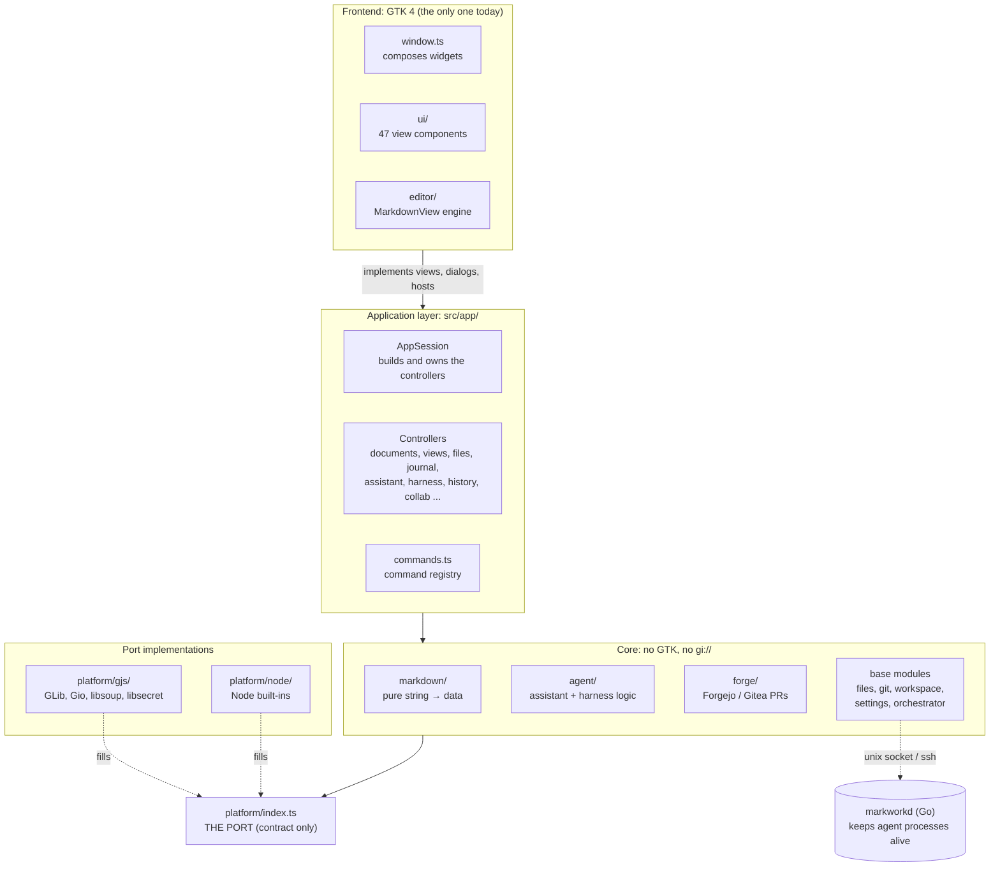

Read it as three bands:

| Band | Question it answers | Can it import GTK? |
| --- | --- | --- |
| Frontend (`window.ts`, `ui/`, `editor/`) | How does it look and feel? | Yes |
| Application (`app/`) | What should happen when the user does X? | **No** |
| Core (`markdown/`, `agent/`, `forge/`, base) | What are the rules? | **No** |

The **port** is how the core touches the outside world (disk, processes, HTTP, keyring). Because the core only sees the port, the same core runs under GJS in the app and under Node in `npm run test:core:node`. A second frontend (Electron is designed in [docs/design/electron.md](design/electron.md)) would reuse the application layer and the core unchanged.

---

## 3. The repository map

```
markwork/
├── src/                     TypeScript, ~36k lines. The app.
│   ├── main.ts, app.ts      entry point → creates Adw.Application → MainWindow
│   ├── window.ts            GTK frontend of AppSession (the only place widgets are wired together)
│   ├── actions.ts           command registry → Gio.Actions + accelerators
│   ├── markdown/            pure Markdown rules and models           (29 files, ~5.0k lines)
│   ├── agent/               the AI assistant + harness logic         (34 files, ~5.7k lines)
│   │   └── daemon/          TypeScript client of markworkd
│   ├── forge/               Forgejo/Gitea pull-request client        ( 8 files, ~0.7k lines)
│   ├── editor/              the editor engine on GtkSourceView       (21 files, ~4.0k lines)
│   ├── ui/                  standalone widgets + .ui templates       (47 files, ~10.3k lines)
│   ├── app/                 application layer, shared by all frontends (24 files, ~5.4k lines)
│   ├── platform/            the port: index.ts (contract), gjs/, node/ (18 files, ~2.0k lines)
│   ├── window/              small GTK glue left over (Doc type, harness log windows)
│   └── files.ts, git.ts, workspace.ts, settings.ts, orchestrator.ts, ...   base modules of the core
├── markworkd/               Go module, standard library only. A supervisor daemon.
├── tests/
│   ├── unit/                tests without a window (62 files, one per module)
│   ├── gui/                 tests with a real window on Xvfb (35 files)
│   ├── core-tests.ts        the list that runs on GJS *and* Node
│   └── run-tests.ts         the GJS runner (unit + GUI)
├── scripts/                 layers.mjs (architecture guard), dev.mjs, capture.ts (docs screenshots)
├── data/                    GSettings schema, .desktop, metainfo, icons
├── docs/                    user docs (docs/docs/*.html), design docs, learn-*.html, this file
├── bench/                   performance baselines
└── build-aux/, po/, meson.build   Flatpak, translations, install
```

Where the code is, by size:

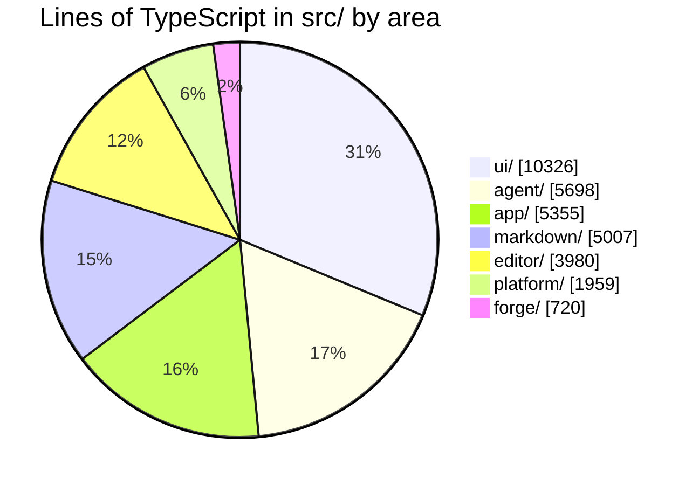

(The rest is `window.ts`, `orchestrator.ts`, and the base modules. Numbers are from October 2026; they drift, the proportions do not.)

---

## 4. The layers and the one rule

> **A lower layer must never import an upper layer.**

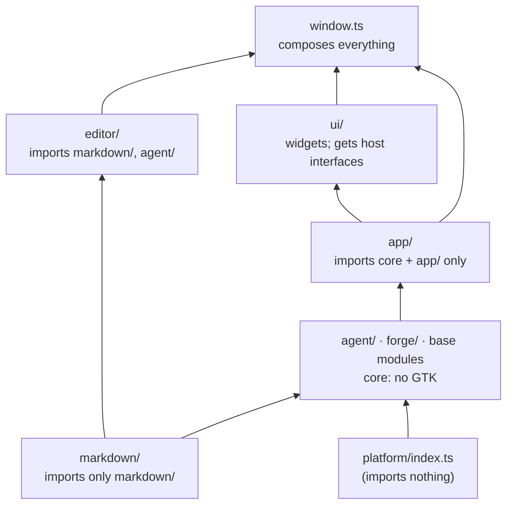

(Arrows point from the lower layer to the layers allowed to depend on it.)

This is **not a convention, it is a build step**. `scripts/layers.mjs` parses every file in `src/` and fails `npm run build` on a violation. The main rules:

| Folder | May not import | Why |
| --- | --- | --- |
| `markdown/` | `gi://`, anything outside `markdown/` | Only `string → data` functions: trivial to test |
| `agent/`, `forge/` | GTK, `ui/`, `editor/`, `window` | The agent must not know about widgets |
| the whole core | `gi://`, `gjs:` built-ins, `platform/gjs/`, `app/` | It reaches the runtime only through `platform()` |
| `app/` | `gi://`, `ui/`, `window` | Shared by every frontend |
| `editor/` | `ui/`, `window`, `agent/` | The editor reports through callbacks |
| `ui/` | `window.ts`; core modules that *act* (touch disk/git) | A view draws and reports; work goes through `app/` |
| everything but `platform/node/` | `node:*` | Only the Node port may use Node |

The same script enforces a **cyclomatic complexity limit of 15 per function**. The exception lists (`GI_ALLOWED`, `UI_ACTS_ALLOWED`, `COMPLEXITY_ALLOWED`) are all empty and may not grow.

If `npm run build` says `imports X (… reason …)`, the message already tells you which rule you hit. Fix the design, do not add an exception.

---

## 5. The platform port

[`src/platform/index.ts`](../src/platform/index.ts) is about 200 lines of interfaces and imports nothing. It lists everything the core may ask of the world:

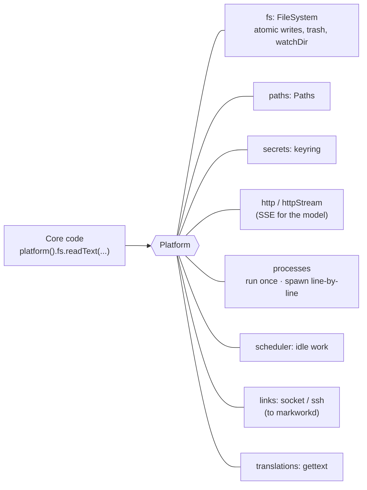

Implementations:

| Folder | Built from | Used by |
| --- | --- | --- |
| `platform/gjs/` | GLib, Gio, libsoup, libsecret, GSettings | The real app, the GUI tests |
| `platform/node/` | Node built-ins only | `npm run test:core:node`, a future Electron core |

Every entry point (`main.ts`, the test runner, benchmarks, `scripts/capture.ts`) starts with `import './platform/gjs/install.js'`, which calls `setPlatform(...)`. A test can replace the platform with a fake.

`tests/unit/platform.ts` holds both implementations to the same contract, so "works on GJS, breaks on Node" is caught.

---

## 6. The application layer: AppSession and controllers

`src/app/` is where decisions live. It is large because the GTK window used to do all of this; it was moved out so a second frontend could reuse it.

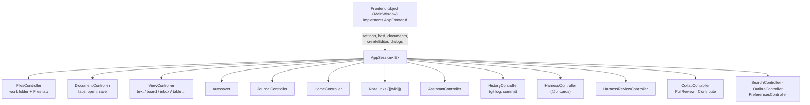

### The host pattern (the most important idiom here)

A controller never receives "the window". It declares **the small interface it needs** and the frontend fills it.

```ts
// app/autosave.ts, schematically
export interface AutosaveHost { /* only what Autosaver needs */ }
export class Autosaver { constructor(host: AutosaveHost) { ... } }
```

`AppSession` builds one `host` object and every controller sees only its own slice of it:

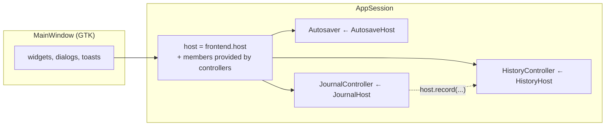

Three kinds of things cross this boundary, and only these:

| Kind | Example | Rule |
| --- | --- | --- |
| **Views** (interfaces with `on*` callbacks) | `ChatPanelView`, `HistoryTabView` | Plain data in, `on*` actions out |
| **Dialogs** (`AppDialogs`) | `confirm`, `chooseFile` | A function that returns a value or a `Promise` |
| **Hosts** | `DocumentsHost`, `HarnessHost` | What the controller needs from the frontend |

"Plain data" is checked by `tests/unit/plaindata.ts`: no `Set`, `Date`, callbacks, or live objects like `Doc` in `AppFrontend`/`AppDialogs`. Reason: each call must be serializable into a JSON message one day.

### Commands

[`app/commands.ts`](../src/app/commands.ts) is a table: `id`, palette label, default keys, scope, `run(host)`. [`actions.ts`](../src/actions.ts) turns that table into `Gio.Action`s and accelerators. A command acts only through `CommandHost`, so it never touches a widget.

---

## 7. The GTK frontend

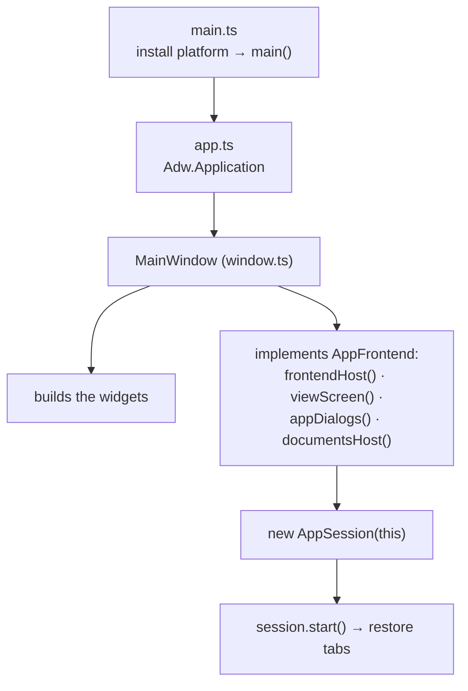

Window anatomy (matches the layout block in `MainWindow`'s constructor):

```
┌ HeaderBar ──────────────────────────────────────────────────────┐
│ Sidebar            │ TabBar (when ≥ 2 documents)                │
│ ┌Files·Outline·    │ FindBar                                    │
│ │ History·Search┐  │ ┌─────────────────────────┬──────────────┐ │
│ │ FileTree /     │ │ │ content (Gtk.Stack):    │ Assistant    │ │
│ │ Outline /      │ │ │  MarkdownView | Board | │ panel        │ │
│ │ History        │ │ │  Inbox | Table | Home | │ (ChatPanel)  │ │
│ └────────────────┘ │ │  Calendar | Pull | ...  │              │ │
│                    │ └─────────────────────────┴──────────────┘ │
│                    │ StatusBar                                  │
└────────────────────┴────────────────────────────────────────────┘
```

- **One `MarkdownView` per tab.** Undo, cursor, scroll are kept per document. Never hold `w.editor` in a long-lived variable: it is a getter for the *active* document.
- **`window.ts` (~930 lines) is only wiring.** If a feature adds more than a few methods there, make it a controller in `app/`.
- **`ui/` components are views.** They draw plain data and report with `on*` callbacks. Static layout goes in a `.ui` template (`chat.ui`, `preferences.ui`, ...).
- UI follows the **GNOME HIG and libadwaita**: `Adw.*` first, then GTK 4, then Adwaita style classes, then your own CSS in `ui/theme.ts`. Text goes through `_()` for translation.

---

## 8. The Markdown model and the editor

### 8.1 `markdown/`: pure models

Every module takes a string (or a parsed structure) and returns **new** data; none mutates its arguments.

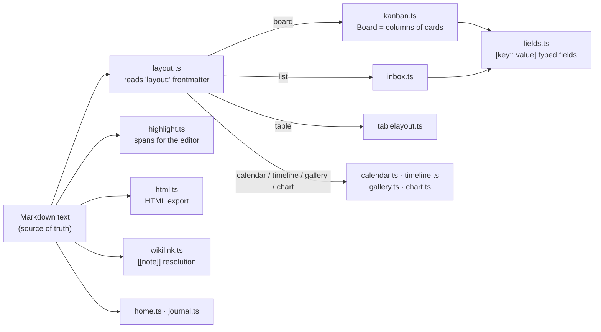

Format cheat sheet (all plain Markdown, nothing proprietary):

```markdown
---
layout: board                  # makes this file a kanban board
---
## Plan                        # level-2 heading = a column
- [ ] Fix checkout [due:: 2026-10-20] [agent:: pi] #web   # list item = a card
  a note about the card (indented)
```

A parser **never rejects or rewrites text it does not understand**. That is what makes it safe to share a file with a human editing by hand.

### 8.2 `editor/`: the engine on top of GtkSourceView

`MarkdownView` ([`editor/view.ts`](../src/editor/view.ts)) is a `GtkSourceView` plus small layers, each owning one concern:

| Module | Concern |
| --- | --- |
| `tags.ts`, `highlighter.ts`, `tagsync.ts` | Styles: parse lines (`markdown/highlight.ts`), apply as text tags, only for changed lines (`LineTagger`) |
| `decorations.ts` | Hide/show Markdown markers depending on the cursor line (`MarkerConcealer`) |
| `lists.ts`, `listindent.ts`, `editing.ts` | Enter/Tab in lists, format commands |
| `images.ts`, `tablelayer.ts`, `mermaid.ts`, `codelayer.ts` | **Overlay widgets** drawn above empty space (not buffer content) |
| `wikicomplete.ts` | `[[` note-name suggestions |
| `overlays.ts` | `OverlaySlots`: GTK 4 overlays cannot be detached, so slots are borrowed and released |

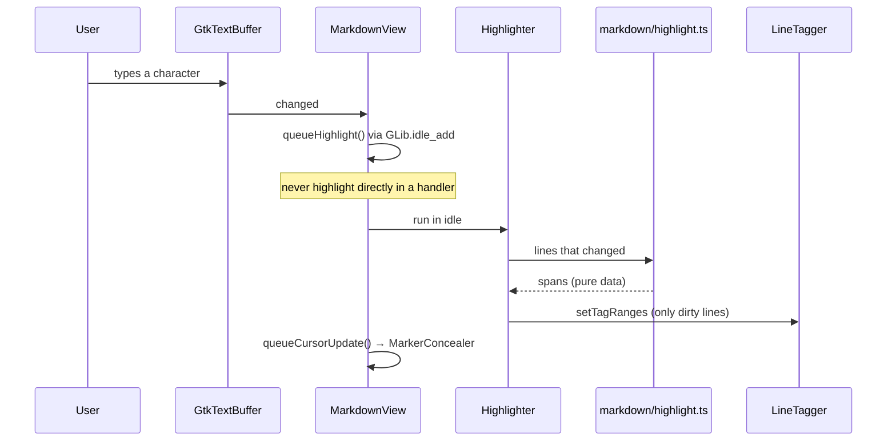

Key point: parsing is **pure** and testable without a window; only applying the result touches GTK.

---

## 9. Flows, step by step

### 9.1 Starting the app

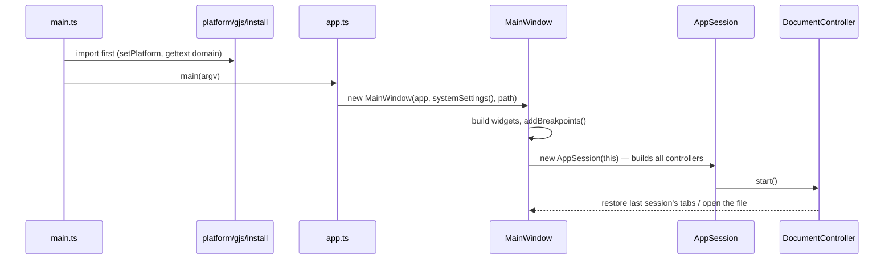

### 9.2 Editing a kanban card

The buffer is the source of truth; the board is a view.

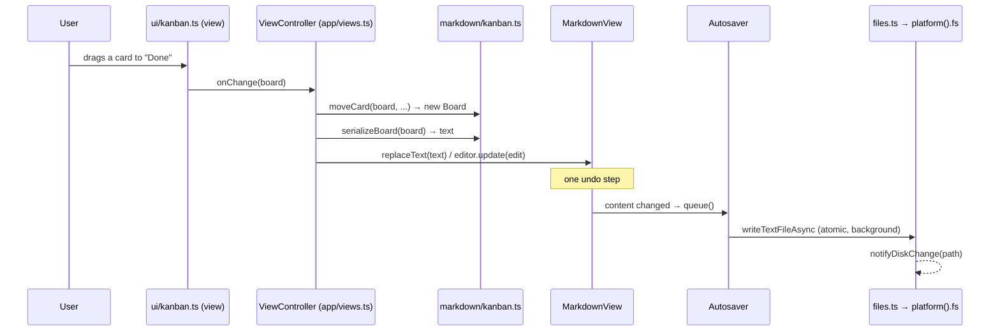

### 9.3 Saving and watching the folder

- Writes go through `files.ts`: a write first waits for older background writes to the same path, and every change is announced (`onDiskChange`). A synchronous write/move/delete must call `flushWrites()`.
- `workspace.ts` (`WorkspaceRepository`) keeps a snapshot of the Markdown files (size + mtime), watches the folders, and caches contents. Unsaved documents are read from their editor, not from disk. Home, the chat context, `[[` suggestions, and harness prompts all read the folder through it.

---

## 10. The AI side: Assistant and harness

There are **two different agent features**. They share a vocabulary but not code paths.

| | Assistant | Harness (`@pi` cards) |
| --- | --- | --- |
| What it is | A chat panel with a model (DeepSeek) | An external coding agent (pi) run on a kanban card |
| Where it works | Reads your Markdown folder | In a **project folder**, in its own Git worktree |
| Writes files? | Only proposals you Apply | Only in its worktree; you review and merge |
| Code | `agent/session.ts`, `agent/chatcontroller.ts`, `app/assistant.ts` | `orchestrator.ts`, `agent/harness.ts`, `app/harness.ts` |

### 10.1 One Assistant turn

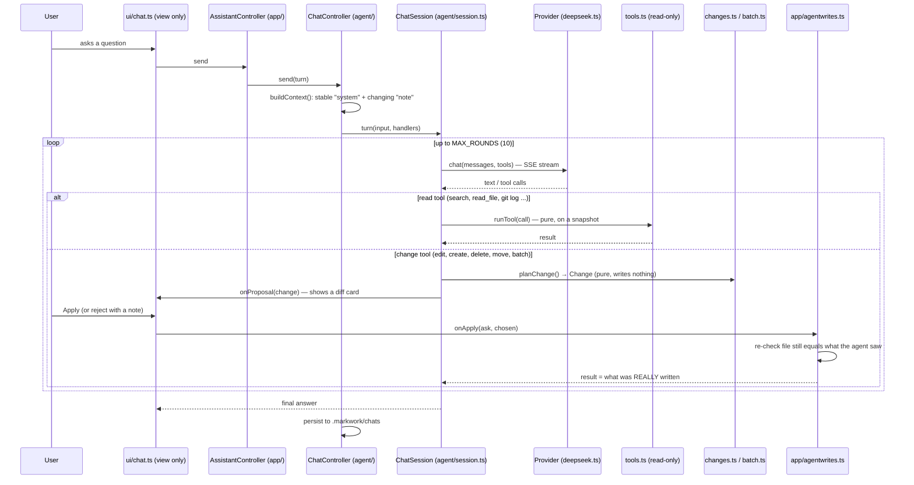

Rules worth memorising:

- **Read tools** (`TOOLS` in `agent/tools.ts`) are pure and work on a `SourceFile[]` snapshot, never the disk, so they cannot escape the project.
- **Change tools** (`CHANGE_TOOLS` in `agent/changes.ts`) only *produce* a `Change`. Applying happens in `app/agentwrites.ts` after approval, and it must **re-check** that the file did not change meanwhile and that the name is safe (`agent/path.ts` checks symlinks).
- **The result the agent sees is what the core wrote**, never what the panel claims.
- **Prompt-cache friendly:** the `system` part stays stable between questions; anything that changes goes in `note`.
- Tests never call the real API: use a fake `Provider` and fake `KeyStore`.
- Context pipeline: selection → active doc → @mentions → project map → BM25 excerpts, all under a token budget.

### 10.2 A harness run (`@pi` card)


Facts to keep in mind:

- The **project folder** comes from `settings.projects` (chosen via a folder dialog), never from Markdown content or from the agent. `checkProjectFolder()` rejects the Markwork work folder itself.
- Markwork **writes to a project folder only when the user confirms a merge.**
- Git is always a `GitRunner` parameter: `runGit` locally, `daemonGit()` through markworkd on another machine. Keep it a parameter so the same code runs on both.
- A run has statuses; `waiting` means the agent asked the user something and still holds its folder's queue slot.
- The pure parts (prompt, `PiReader`, `RunQueue`) are in `agent/harness.ts` and have unit tests; the GUI test uses a fake pi shell script.

---

## 11. markworkd, the Go daemon

**Problem:** an agent run should survive closing the window, a crash, or a dropped SSH link.
**Solution:** a small supervisor per machine. It owns the processes and keeps an append-only **log** per run; clients subscribe from a sequence number and replay what they missed.

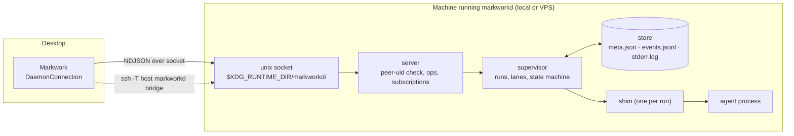

Go package layout (dependencies flow left to right, no cycles):

```
model  →  protocol, store, runner, config  →  supervisor  →  server  →  cmd/markworkd
                                    client (typed Go client) depends only on protocol + model
```

| Package | One-line job |
| --- | --- |
| `model` | Shared types; JSON tags are the wire format |
| `protocol` | NDJSON envelopes, op names, error codes (max frame 16 MiB) |
| `store` | On-disk layout per run |
| `runner` | Start **one** process; knows nothing about runs or lanes |
| `supervisor` | Registry of runs, **lanes** (a project = at most N concurrent runs), recovery |
| `shim` | Per-run helper so agents outlive a daemon restart |
| `server` | Listener, per-connection session, `subscribe`/`watch` |
| `bridge`, `daemonize`, `client`, `config` | SSH stdio proxy, background start, Go client, paths + config |

Principles: **protocol-agnostic** (the daemon moves lines and never parses an agent's output; all meaning is in `agent/harness.ts`), **the log is the single source of truth** (a run's state is a fold over its records), **no network listener** (OS permissions + SSH only).

TypeScript side: `src/agent/daemon/` (protocol, client, reconnecting connection, `streamlink.ts`), `src/orchestratordaemon.ts` (the `Spawner` adapter), `src/daemonhub.ts` (which machines are connected), `src/window/harness.ts`. Details: [docs/design/markworkd.md](design/markworkd.md).

---

## 12. Build, run, and test

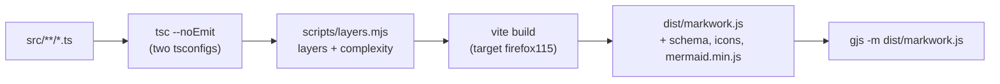

| Command | Use it for |
| --- | --- |
| `npm install` | once |
| `npm start` | build and run |
| `npm run dev` | rebuild and relaunch on every save (GJS has no HMR) |
| `npm run typecheck` | types + layer rules, fastest feedback |
| `npm test` | everything on a virtual display (Xvfb): unit + GUI + mouse |
| `npm run test:core:node` | the core's tests on **Node**, no display |
| `npm run bench:compare` | performance vs `bench/baseline.json` |
| `cd markworkd && go vet ./... && go test -race ./...` | the daemon |

The test pyramid:

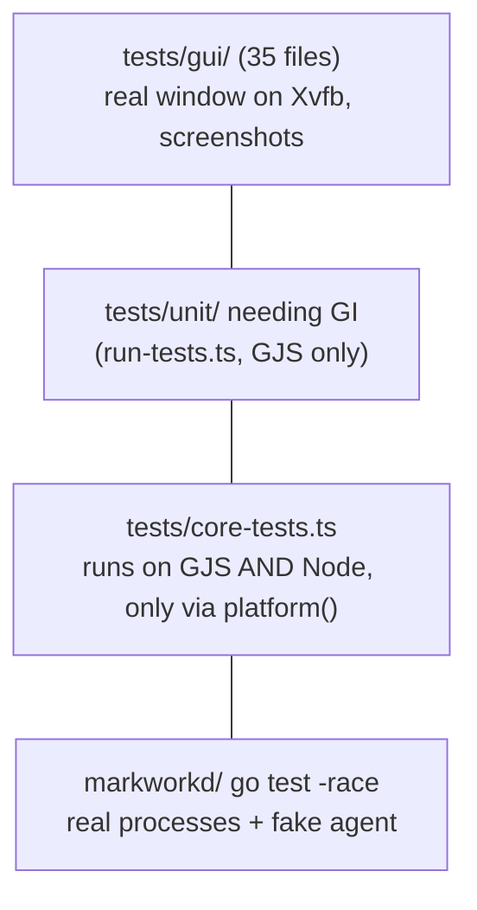

Conventions that save time:

- Tests run from `dist/`, so **rebuild before running** `gjs -m dist/run-tests.js`.
- A test log must be **clean**, not just "0 failed": grep for `CRITICAL|WARNING|Traceback` (see AGENT.md).
- Tests use `AppSettings.inMemory()` and temp folders; never the user's dconf or home.
- A modal dialog returns a `Promise` and must be replaceable in tests (`w.session.*.dialogs`).
- UI changes need a real screenshot (`widgetPixbuf()` in `tests/widgets.ts`); code changes need a benchmark.

---

## 13. Recipes: where does my change go?

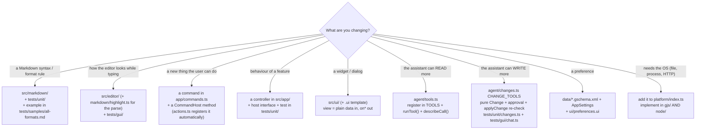

Worked example: **"Add a command that archives the done cards"**

1. Pure logic: `archiveDone(board): Board` in `src/markdown/kanban.ts`, plus a test in `tests/unit/kanban.ts`.
2. A `CommandHost` method (e.g. `archiveDone()`) in `app/commands.ts`, with the command entry (id, label via `_()`, default keys, scope).
3. Implement it in `ViewController` (`app/views.ts`) using `currentBoard()` and `commitBoard()`, so it is one undo step.
4. `window.ts`/`actions.ts` need nothing: the table is mapped to actions automatically.
5. Update the docs page (`docs/docs/kanban.html`) and the README shortcut table.

Also required by AGENT.md when relevant: the matching `docs/learn-*.html` page, `po/POTFILES.in` for new translatable text, and one `type(module): description` commit per logical change.

---

## 14. Pitfalls that cost people days

| Symptom | Cause | Rule |
| --- | --- | --- |
| Cursor/tag off by one with emoji | GtkTextBuffer counts code points; JS counts UTF-16 units | Convert with `makeCpMap()` (`markdown/offsets.ts`) |
| Whole document re-lays out, typing lags | `remove_tag()` over the buffer, or margin changes at runtime | Use `setTagRanges()` / `LineTagger`; never touch margins |
| Opening a 650 KB file freezes | Setting the whole text at once | Use `replaceAllText()`; highlighting is incremental (`queueFill()`) |
| `Gjs-CRITICAL … already disposed` | An idle/timeout runs after the widget is destroyed | Check the `destroyed` flag; components provide `destroy()` |
| Images/tables won't scroll or detach | They are overlays, not buffer content; GTK 4.14 can't detach them | Use `OverlaySlots`: `place()` / `release()` |
| A lost async result (rare) | GJS blocks JS callbacks that arrive during GC | Give anything awaited an end that does not depend on the callback (see `runGit()` watchdog) |
| Edits overwritten by autosave/agent | Reading text back after your own write | Use `editor.update(edit)`; `LaggingEditor` test catches it |
| `npm run build` fails on imports | You crossed a layer | Read the message in `layers.mjs`; fix the design |
| New dialog hangs a test | Real modal in a test | Dialogs return a Promise and must be replaceable |
| Window widens by itself | `hexpand` propagates upward in GTK 4 | Panels get explicit `hexpand: false`; hscroll policy `EXTERNAL` |

The complete list, with reasons, is "Known pitfalls" in [AGENT.md](../AGENT.md).

---

## 15. Glossary and reading order

| Term | Meaning |
| --- | --- |
| **Work folder** | The folder of Markdown files the user opened. The workspace. |
| **Core** | Everything that is not interface: `markdown/`, `agent/`, `forge/`, base modules, orchestrator. |
| **Port** | `platform/index.ts`: the one contract between the core and the runtime. |
| **AppSession** | The object that builds and owns all application controllers for one frontend. |
| **Controller** | A class in `app/` that owns one feature's behaviour. |
| **Host** | The slice of the frontend a controller is allowed to call. |
| **View** | A widget interface: plain data in, `on*` callbacks out. |
| **Doc** | One open tab: file, editor, state. |
| **Change / proposal** | A pure description of an agent's file edit; written only after Apply. |
| **Harness** | An external agent program (pi) that works a kanban card. |
| **Worktree** | A per-card Git worktree/branch where the harness works. |
| **markworkd** | The Go daemon that owns agent processes. |
| **Run / record / lane** | One agent process / one log entry / a concurrency queue keyed by project. |
| **Shim** | A per-run helper that keeps an agent alive across daemon restarts. |
| **Frontmatter `layout:`** | The line that turns a Markdown file into a board, list, table, calendar... |

**Suggested reading order for your first week**

1. This file, then [AGENT.md](../AGENT.md) (rules) and the "Goal" section of [README.md](../README.md).
2. [`scripts/layers.mjs`](../scripts/layers.mjs): read the `rules` array; it is the architecture in 40 lines.
3. [`src/platform/index.ts`](../src/platform/index.ts): the port.
4. [`src/app/session.ts`](../src/app/session.ts): how the controllers are wired; then one small controller (`app/autosave.ts`).
5. [`src/markdown/kanban.ts`](../src/markdown/kanban.ts) and its test `tests/unit/kanban.ts`: the pure-model style.
6. [`src/window.ts`](../src/window.ts): how a frontend fills the hosts (skim the constructor).
7. [`src/agent/session.ts`](../src/agent/session.ts) and [`src/agent/changes.ts`](../src/agent/changes.ts): the Assistant loop and the approval boundary.
8. [`docs/design/markworkd.md`](design/markworkd.md) and [`docs/design/protocol.md`](design/protocol.md) when you touch agents-on-other-machines or a second frontend.
9. Run `npm test`, then make a tiny change in `markdown/` with its test, to feel the loop.

**Where the design documents are**

| Document | About |
| --- | --- |
| [design/markworkd.md](design/markworkd.md) | The daemon: protocol, storage, failure behaviour, shims |
| [design/protocol.md](design/protocol.md) | The (not yet implemented) app protocol for a frontend in another process |
| [design/electron.md](design/electron.md) | The path to an Electron frontend (Indonesian) |
| [learn-agent.html](learn-agent.html), [learn-gtk.html](learn-gtk.html), [learn-clean-code.html](learn-clean-code.html), [learn-performance.html](learn-performance.html) | Illustrated histories of how each area grew |
