# Markwork onboarding: how the code is built

A guide for a new developer. Read it top to bottom once (about 30 minutes), then use it as a map. Every diagram is [Mermaid](https://mermaid.js.org/), so GitHub and most Markdown viewers draw them.

For the rules you must follow when changing code, read [AGENT.md](../AGENT.md). For the full feature reference, read [README.md](../README.md). This document is the part in between: **the shape of the system and why it has that shape**.

- [1. What Markwork is](#1-what-markwork-is)
- [2. The big picture](#2-the-big-picture)
- [3. The repository map](#3-the-repository-map)
- [4. The layers and the one rule](#4-the-layers-and-the-one-rule)
- [5. The platform port](#5-the-platform-port)
- [6. The application layer: AppSession and controllers](#6-the-application-layer-appsession-and-controllers)
- [7. The protocol and the window](#7-the-protocol-and-the-window)
- [8. The Markdown model and the editor](#8-the-markdown-model-and-the-editor)
- [9. Flows, step by step](#9-flows-step-by-step)
- [10. The AI side: Assistant and harness](#10-the-ai-side-assistant-and-harness)
- [11. markworkd, the Go daemon](#11-markworkd-the-go-daemon)
- [12. Build, run, and test](#12-build-run-and-test)
- [13. Recipes: where does my change go?](#13-recipes-where-does-my-change-go)
- [14. Pitfalls that cost people days](#14-pitfalls-that-cost-people-days)
- [15. Glossary and reading order](#15-glossary-and-reading-order)

---

## 1. What Markwork is

A **Markdown workspace for humans and AI agents** for Linux, macOS, and Windows. One folder of `.md` files is the whole database: notes, kanban boards, an inbox, a daily journal, a Home page, Git history, and an AI assistant that understands that folder.

Three ideas explain most design decisions:

1. **The Markdown text is the single source of truth.** A kanban board, an inbox, a table are *views* of text. Every change goes back to the text, so undo, Git, and the agent all see the same thing.
2. **The agent proposes, the human applies.** The Assistant reads freely but never writes by itself. Every file action is a proposal the user reviews and applies (and can undo).
3. **The core does not know the interface.** Everything that is a decision (what a tab does, when to save, what a proposal means) lives in plain TypeScript that runs on Node. The window draws what it is told.

Stack: **TypeScript**, bundled by **Vite**. The app is **Electron**: the core (`src/`) runs in a Node utility process, the window (`electron/renderer/`) is **React** with **CodeMirror 6**, and they talk over the app protocol. A separate **Go** daemon, `markworkd`, keeps agent processes alive. (Until 20 October 2026 the window was GTK 4; the tag `v-gtk-final` keeps it.)

---

## 2. The big picture

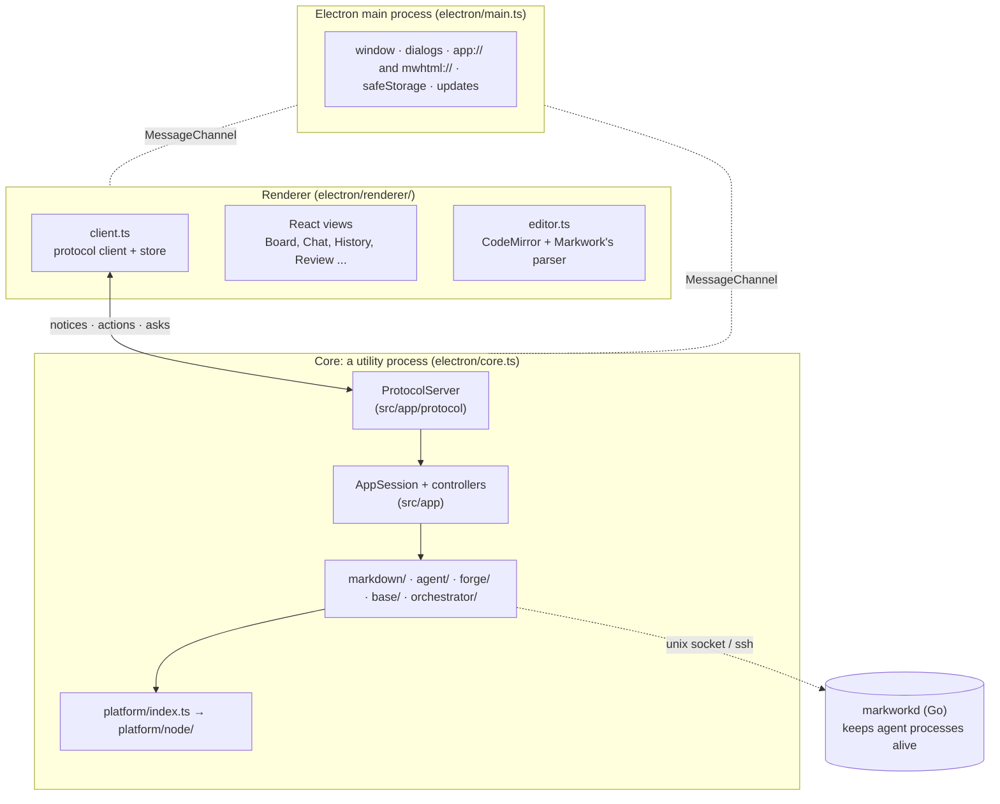

Read it as three bands:

| Band | Question it answers | Where |
| --- | --- | --- |
| The window | How does it look and feel? | `electron/renderer/`, `electron/main.ts` |
| Application | What should happen when the user does X? | `src/app/` |
| Core | What are the rules? | `src/markdown/`, `src/agent/`, `src/forge/`, `src/base/`, `src/orchestrator/` |

The **port** is how the core touches the outside world (disk, processes, HTTP, keyring). The core only sees the port, so its tests run on Node with a fake or the real port, without a window.

---

## 3. The repository map

```
markwork/
├── electron/                The app shell
│   ├── main.ts              the main process: window, core process, dialogs, URL schemes, keychain
│   ├── core.ts              the core's entry: Node platform + ProtocolServer
│   ├── preload.ts, updater.ts
│   └── renderer/            the page: client.ts, App.tsx, editor.ts, one component per view (43 files, ~6.6k lines)
├── src/                     The application, plain TypeScript
│   ├── app/                 application layer + app/protocol/ (57 files, ~8.0k lines)
│   ├── markdown/            pure Markdown rules and models   (38 files, ~5.7k lines)
│   ├── agent/               the AI assistant + harness logic (35 files, ~5.8k lines)
│   │   └── daemon/          TypeScript client of markworkd
│   ├── forge/               Forgejo/Gitea pull-request client ( 9 files, ~0.8k lines)
│   ├── platform/            the port: index.ts (contract) and node/ (12 files, ~1.4k lines)
│   ├── base/                base modules of the core: files, git, workspace, settings, ...
│   └── orchestrator/        runs harness processes (index.ts), through markworkd (daemon.ts, hub.ts)
├── markworkd/               Go module, standard library only. A supervisor daemon.
├── tests/
│   ├── unit/                the core's tests (65 files, one per module)
│   ├── electron/            the app driven by Playwright (13 files)
│   ├── core/                core-tests.ts, run-core-node.ts, the framework and test host
│   ├── live/                live tests against real services (not in npm test)
│   └── bench/               benchmarks and their baseline
├── scripts/                 electron-build.mjs, layers.mjs (architecture guard), capture.mjs (docs screenshots)
├── resources/, electron-builder.yml   the app icon and packaging (AppImage, deb, dmg, NSIS)
├── docs/                    user docs (docs/docs/*.html), design docs, learn-*.html, this file
└── po/                      translations
```

---

## 4. The layers and the one rule

> **A lower layer must never import an upper layer.**

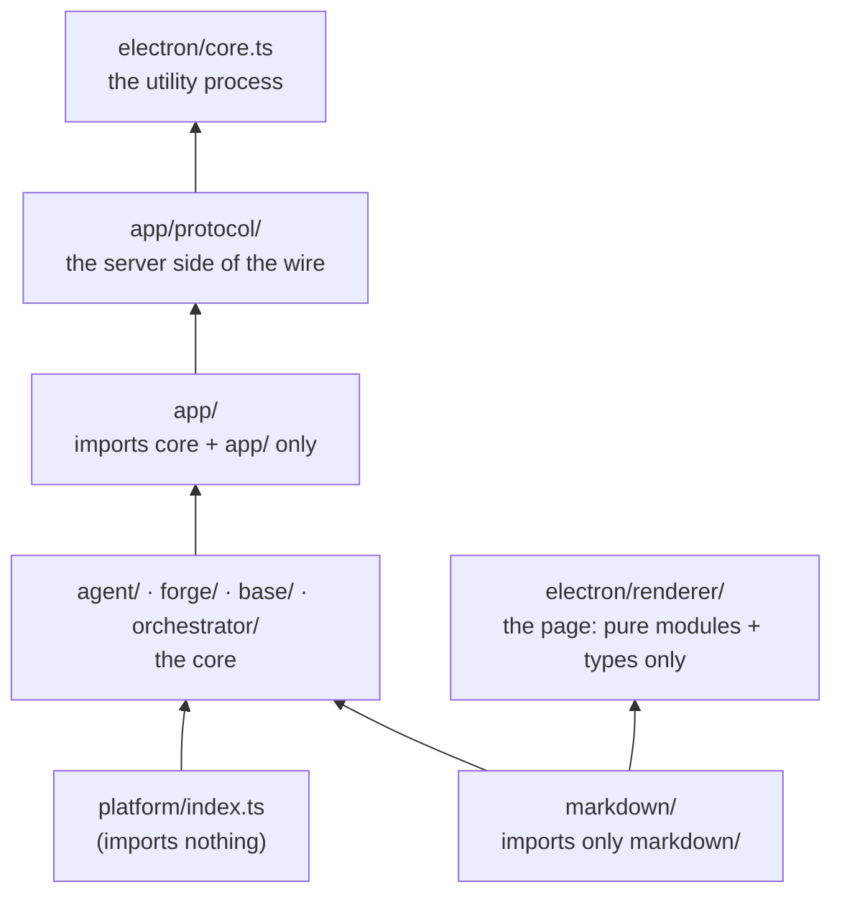

(Arrows point from the lower layer to the layers allowed to depend on it.)

This is **not a convention, it is a build step**. `scripts/layers.mjs` parses every file in `src/` and `electron/renderer/` and fails `npm run build` on a violation. The main rules:

| Folder | May not import | Why |
| --- | --- | --- |
| `markdown/` | anything outside `markdown/` | Only `string → data` functions: trivial to test |
| `forge/` | `agent/` | The forge knows nothing about the agent |
| the whole core | `app/`, anything outside the core | It reaches the runtime only through `platform()` |
| `app/` | anything but the core and `app/` | The application layer has no window of its own |
| everything but `platform/node/` | `node:*` | Only the Node port may use Node |
| everything in `src/` | anything outside `src/` | `electron/` uses `src/`, never the other way round |
| `electron/renderer/` | `node:*`; from `src/` anything but the pure modules and types | The page is a view: it draws and reports |

The same script enforces a **cyclomatic complexity limit of 15 per function**. Its exception list (`COMPLEXITY_ALLOWED`) is empty and may not grow. And the core typechecks against `src/globals.d.ts` only (timers, `TextEncoder`, `TextDecoder`), not Node's types, so a Node global in the core fails `npm run typecheck`.

If `npm run build` says `imports X (… reason …)`, the message already tells you which rule you hit. Fix the design, do not add an exception.

---

## 5. The platform port

[`src/platform/index.ts`](../src/platform/index.ts) is about 200 lines of interfaces and imports nothing. It lists everything the core may ask of the world:

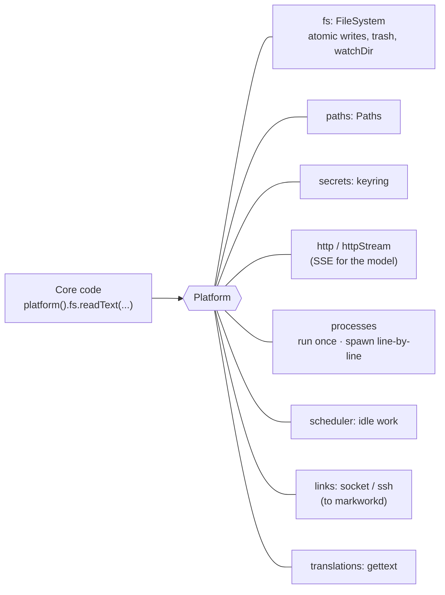

The implementation is `platform/node/`, built from Node built-ins only: files and atomic background writes, the Trash on each system, processes, sockets, `fetch`, `secret-tool` for the keyring on Linux, a JSON settings store checked against the keys in `settingskeys.ts`, and gettext catalogs. On macOS and Windows the keyring is Electron's `safeStorage`, which only the main process can call, so `electron/core.ts` installs secrets that ask the main process (`platform/node/vault.ts`).

Every entry point (`electron/core.ts`, the test runner, the live tests and benchmarks) starts with `import '…/platform/node/install.js'`, which calls `setPlatform(...)`. A test can replace the platform with a fake; `tests/unit/platform.ts` holds the installed platform to the contract, and `tests/unit/crossos.ts` runs what differs per system (folders, program names, terminals) for Linux, macOS, and Windows on one machine.

---

## 6. The application layer: AppSession and controllers

`src/app/` is where decisions live. Every decision of the application is here; the window only draws and reports.

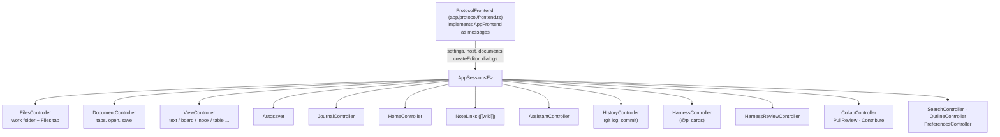

### The host pattern (the most important idiom here)

A controller never receives "the window". It declares **the small interface it needs** and the frontend fills it.

```ts
// app/autosave.ts, schematically
export interface AutosaveHost { /* only what Autosaver needs */ }
export class Autosaver { constructor(host: AutosaveHost) { ... } }
```

`AppSession` builds one `host` object and every controller sees only its own slice of it:

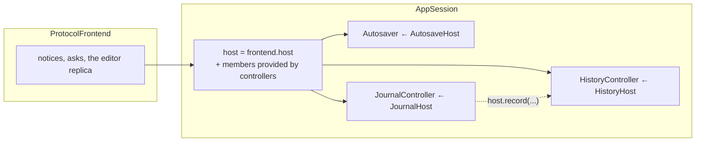

Three kinds of things cross this boundary, and only these:

| Kind | Example | Rule |
| --- | --- | --- |
| **Views** (interfaces with `on*` callbacks) | `ChatPanelView`, `HistoryTabView` | Plain data in, `on*` actions out |
| **Dialogs** (`AppDialogs`) | `confirm`, `chooseFile` | A function that returns a value or a `Promise` |
| **Hosts** | `DocumentsHost`, `HarnessHost` | What the controller needs from the frontend |

"Plain data" is checked by `tests/unit/plaindata.ts`: no `Set`, `Date`, callbacks, or live objects like `Doc` in `AppFrontend`/`AppDialogs`. Reason: each call is a JSON message to the window.

### Commands

[`app/commands.ts`](../src/app/commands.ts) is a table: `id`, palette label, default keys (`Ctrl+Shift+P`; `Ctrl` is `⌘` on macOS), scope, where it runs (`runs`: the core, or the window's editor alone), and `run(host)`. The window takes its keys, menus, and palette from the same table and asks the core which commands apply now (`commands.state`). A command acts only through `CommandHost`, so it never touches the window.

---

## 7. The protocol and the window

The core and the window are two processes. They talk over one `MessageChannel` that the main process hands to both ends; every message is one JSON object ([docs/design/protocol.md](design/protocol.md)).

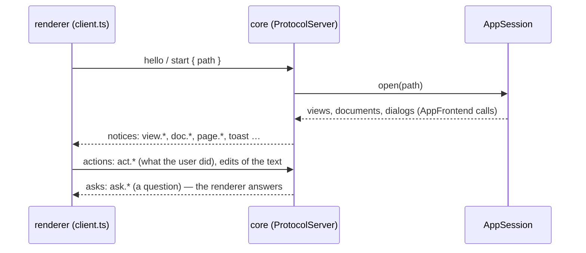

- **Three kinds of messages.** A *notice* (`view.tree`, `view.notes`, `doc.open`, …) tells the window what to show. An *action* (`act.tree.activate`, `act.notes.edit`, `command`, …) reports what the user did, and may get a reply. An *ask* (`ask.saveChanges`, `ask.proposal`, …) is the core asking the user; the window answers with the user's choice. `app/protocol/handlers/` has one file per controller for the actions.
- **The text lives in the editor.** CodeMirror in the renderer holds each document; the window sends its edits (changes in code points, with a version), and the core keeps a replica (`app/protocol/replica.ts`). When the core writes (an applied proposal, a board change) it sends changes against a version, and a write that meets newer typing is made again from the newer text. `LaggingEditor` in the tests plays such an editor.
- **The window is checked, not trusted.** A path, a card, a token, or an answer the window sends back must be one the core offered (`stale` otherwise), and a write it asks for goes through the same checks as one from the agent.
- **The renderer** (`electron/renderer/`) is React. `client.ts` is the protocol client and the store; each view is a component (`Board.tsx`, `Chat.tsx`, `History.tsx`, `Review.tsx`, …); `editor.ts` is CodeMirror with Markwork's parser. Its look copies the former GTK window: a header bar, the icon rail with its panel, centered tabs, counts at the foot, and Adwaita colors and icons. Below 900 px the Assistant floats over the editor, below 600 px the side panel too (`layoutOf` in `client.ts`).
- **The main process** (`electron/main.ts`) owns what only it can: the window, file dialogs, the `app://` scheme for pictures and the `mwhtml://` scheme for HTML pages, the keychain, and updates.

---

## 8. The Markdown model and the editor

### 8.1 `markdown/`: pure models

Every module takes a string (or a parsed structure) and returns **new** data; none mutates its arguments.

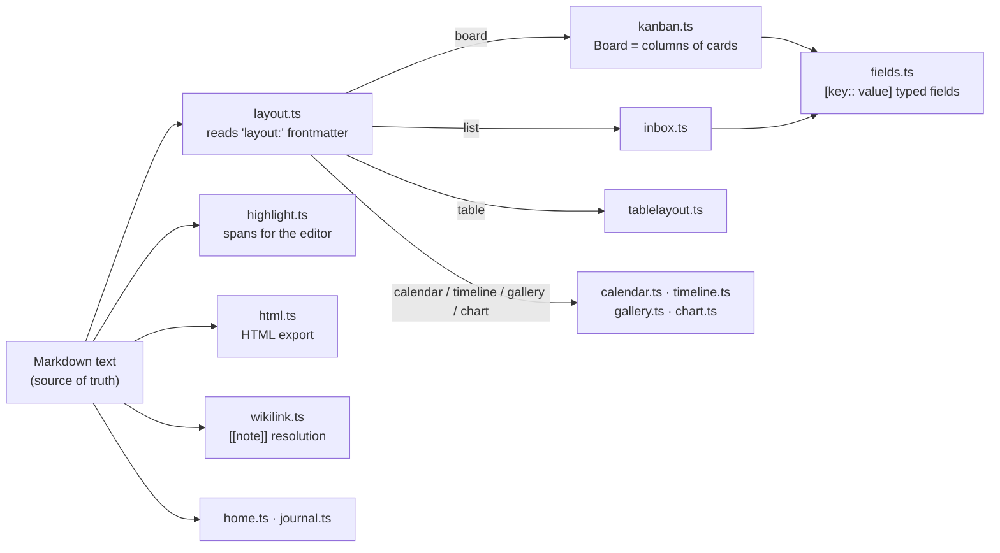

Format cheat sheet (all plain Markdown, nothing proprietary):

```markdown
---
layout: board                  # makes this file a kanban board
---
## Plan                        # level-2 heading = a column
- [ ] Fix checkout [due:: 2026-10-20] [agent:: pi] #web   # list item = a card
  a note about the card (indented)
```

A parser **never rejects or rewrites text it does not understand**. That is what makes it safe to share a file with a human editing by hand.

### 8.2 The editor: CodeMirror with Markwork's parser

`electron/renderer/lib/editor.ts` is CodeMirror 6. Markwork's own parser does the styling, so the editor shows exactly what the HTML export and the core understand:

| Piece | Concern |
| --- | --- |
| `syntaxField` (`editor.ts`) | Parses with `markdown/highlight.ts` (`HighlightCache` reuses unchanged lines) and builds every decoration in the transaction itself: styles, hidden markers away from the cursor, focus dimming |
| `tables.ts`, `codecolor.ts`, `diagrams.ts`, `images.ts`, `conflicts.ts` | Block widgets: a table as a grid, a code box with colors, a Mermaid/DBML diagram, pictures, conflict buttons |
| `markdown/editcommands.ts` | Enter/Tab in lists and tables, format commands: text and selection in, changes out |
| `@codemirror/autocomplete` | `[[` note-name suggestions, from names the core sends |

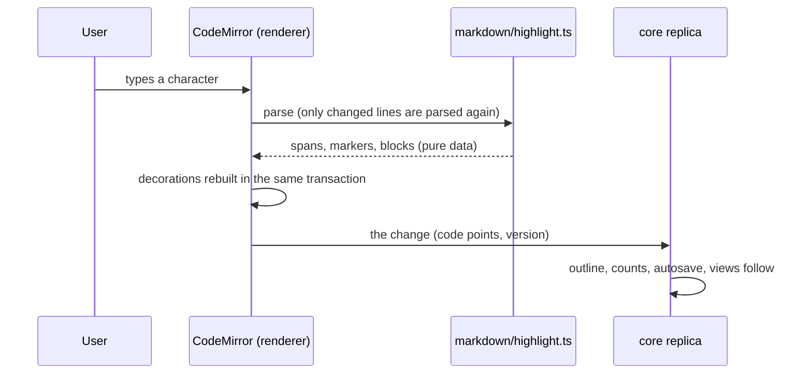

Key point: parsing is **pure** and testable without a window; the decorations only draw its result.

## 9. Flows, step by step

### 9.1 Starting the app

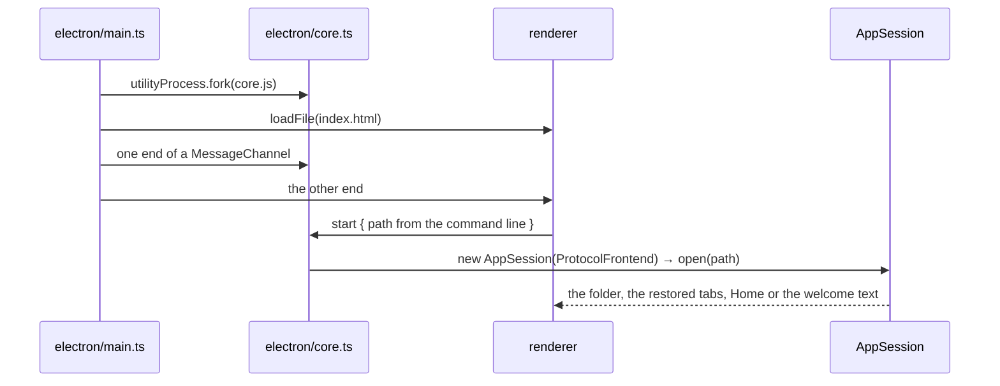

### 9.2 Editing a kanban card

The text is the source of truth; the board is a view.

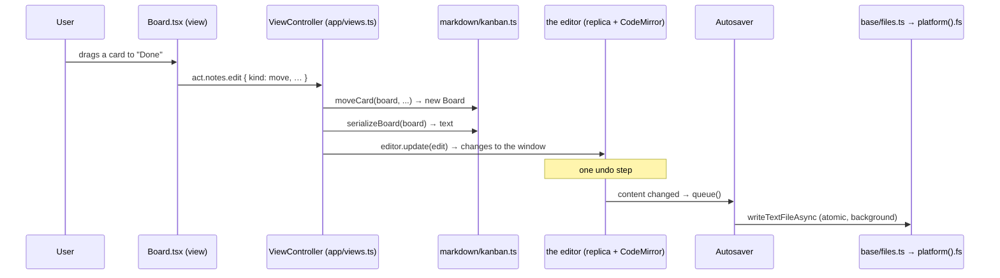

### 9.3 Saving and watching the folder

- Writes go through `base/files.ts`: a write first waits for older background writes to the same path, and every change is announced (`onDiskChange`). A synchronous write/move/delete must call `flushWrites()`.
- `base/workspace.ts` (`WorkspaceRepository`) keeps a snapshot of the Markdown files (size + mtime), watches the folders, and caches contents. Unsaved documents are read from their editor, not from disk. Home, the chat context, `[[` suggestions, and harness prompts all read the folder through it.

---

## 10. The AI side: Assistant and harness

There are **two different agent features**. They share a vocabulary but not code paths.

| | Assistant | Harness (`@pi` cards) |
| --- | --- | --- |
| What it is | A chat panel with a model (DeepSeek) | An external coding agent (pi) run on a kanban card |
| Where it works | Reads your Markdown folder | In a **project folder**, in its own Git worktree |
| Writes files? | Only proposals you Apply | Only in its worktree; you review and merge |
| Code | `agent/session.ts`, `agent/chatcontroller.ts`, `app/assistant.ts` | `orchestrator/index.ts`, `agent/harness.ts`, `app/harness.ts` |

### 10.1 One Assistant turn

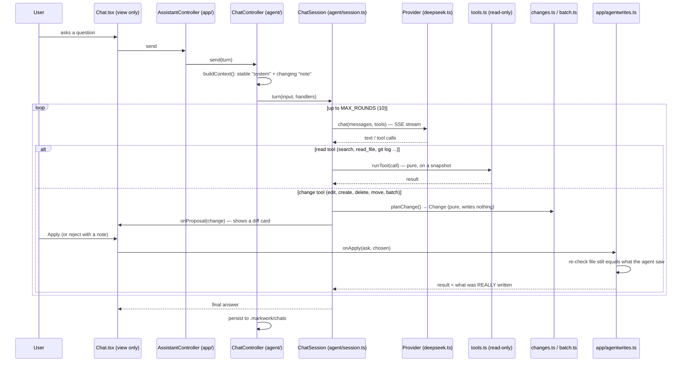

Rules worth memorising:

- **Read tools** (`TOOLS` in `agent/tools.ts`) are pure and work on a `SourceFile[]` snapshot, never the disk, so they cannot escape the project.
- **Change tools** (`CHANGE_TOOLS` in `agent/changes.ts`) only *produce* a `Change`. Applying happens in `app/agentwrites.ts` after approval, and it must **re-check** that the file did not change meanwhile and that the name is safe (`agent/path.ts` checks symlinks).
- **The result the agent sees is what the core wrote**, never what the panel claims.
- **Prompt-cache friendly:** the `system` part stays stable between questions; anything that changes goes in `note`.
- Tests never call the real API: use a fake `Provider` and fake `KeyStore`.
- Context pipeline: selection → active doc → @mentions → project map → BM25 excerpts, all under a token budget.

### 10.2 A harness run (`@pi` card)

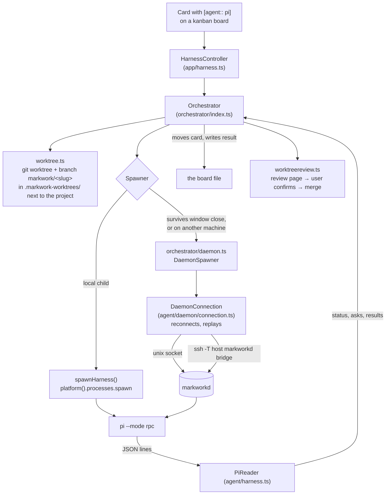

Facts to keep in mind:

- The **project folder** comes from `settings.projects` (chosen via a folder dialog), never from Markdown content or from the agent. `checkProjectFolder()` rejects the Markwork work folder itself.
- Markwork **writes to a project folder only when the user confirms a merge.**
- Git is always a `GitRunner` parameter: `runGit` locally, `daemonGit()` through markworkd on another machine. Keep it a parameter so the same code runs on both.
- A run has statuses; `waiting` means the agent asked the user something and still holds its folder's queue slot.
- The pure parts (prompt, `PiReader`, `RunQueue`) are in `agent/harness.ts` and have unit tests; the app test (`tests/electron/harness.mjs`) uses a fake agent.

---

## 11. markworkd, the Go daemon

**Problem:** an agent run should survive closing the window, a crash, or a dropped SSH link.
**Solution:** a small supervisor per machine. It owns the processes and keeps an append-only **log** per run; clients subscribe from a sequence number and replay what they missed.

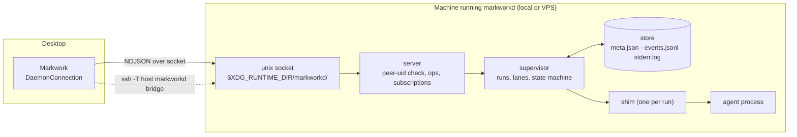

Go package layout (dependencies flow left to right, no cycles):

```
model  →  protocol, store, runner, config  →  supervisor  →  server  →  cmd/markworkd
                                    client (typed Go client) depends only on protocol + model
```

| Package | One-line job |
| --- | --- |
| `model` | Shared types; JSON tags are the wire format |
| `protocol` | NDJSON envelopes, op names, error codes (max frame 16 MiB) |
| `store` | On-disk layout per run |
| `runner` | Start **one** process; knows nothing about runs or lanes |
| `supervisor` | Registry of runs, **lanes** (a project = at most N concurrent runs), recovery |
| `shim` | Per-run helper so agents outlive a daemon restart |
| `server` | Listener, per-connection session, `subscribe`/`watch` |
| `bridge`, `daemonize`, `client`, `config` | SSH stdio proxy, background start, Go client, paths + config |

Principles: **protocol-agnostic** (the daemon moves lines and never parses an agent's output; all meaning is in `agent/harness.ts`), **the log is the single source of truth** (a run's state is a fold over its records), **no network listener** (OS permissions + SSH only).

TypeScript side: `src/agent/daemon/` (protocol, client, reconnecting connection, `streamlink.ts`), `src/orchestrator/daemon.ts` (the `Spawner` adapter), `src/orchestrator/hub.ts` (which machines are connected), `src/app/harness.ts`. markworkd runs on Linux; on macOS and Windows agents run as children of the app. Details: [docs/design/markworkd.md](design/markworkd.md).

---

## 12. Build, run, and test

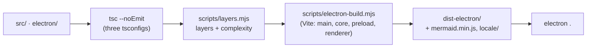

| Command | Use it for |
| --- | --- |
| `npm install` | once |
| `npm start` | build and open the app (`npm start -- <folder>`) |
| `npm run typecheck` | types + layer rules, fastest feedback |
| `npm run test:core:node` | the core's tests on Node, no display |
| `npm run test:electron` | the app driven by Playwright under Xvfb |
| `npm test` | both |
| `npm run bench:compare` | the Markdown module's performance vs `tests/bench/baseline.json` |
| `npm run docs` | retake the screenshots in `docs/assets/` |
| `cd markworkd && go vet ./... && go test -race ./...` | the daemon |

The test pyramid:

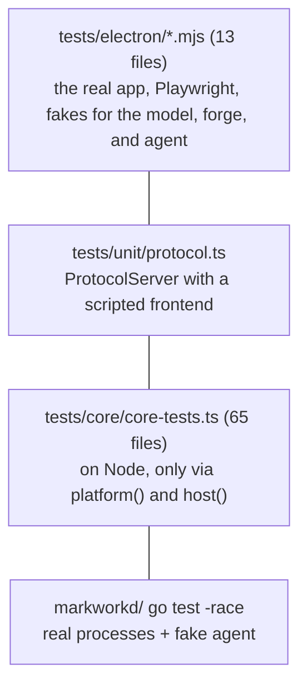

Conventions that save time:

- The Electron tests run the built app, so **rebuild** (`npm run electron:build`) before running one file with `node tests/electron/<name>.mjs`.
- A test log must be **clean**, not just "0 failed" (see AGENT.md).
- Tests use in-memory settings or their own settings folder, and temporary folders; never the user's.
- Tests wait for what they expect, not a fixed time.
- UI changes need a real screenshot (Playwright on Xvfb); code changes need a benchmark.

---

## 13. Recipes: where does my change go?

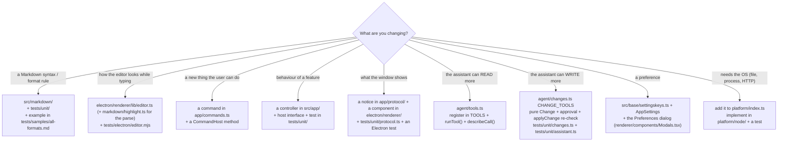

Worked example: **"Add a command that archives the done cards"**

1. Pure logic: `archiveDone(board): Board` in `src/markdown/kanban.ts`, plus a test in `tests/unit/kanban.ts`.
2. A `CommandHost` method (e.g. `archiveDone()`) in `app/commands.ts`, with the command entry (id, label via `_()`, default keys, scope).
3. Implement it in `ViewController` (`app/views.ts`) using `currentBoard()` and `commitBoard()`, so it is one undo step.
4. The window needs nothing: it takes the command from the table and the core tells it when it applies.
5. A step in `tests/electron/structured.mjs`, the docs page (`docs/docs/kanban.html`), and the README shortcut table.

Also required by AGENT.md when relevant: the matching `docs/learn-*.html` page, `po/POTFILES.in` for new translatable text, and one `type(module): description` commit per logical change.

---

## 14. Pitfalls that cost people days

| Symptom | Cause | Rule |
| --- | --- | --- |
| Cursor or change off by one with emoji | The protocol counts code points; JS and CodeMirror count UTF-16 units | Convert with `markdown/offsets.ts` at the editor's edge |
| Edits overwritten by an agent or a board change | Reading text back after your own write, while typing is on its way | Use `editor.update(edit)`; the `LaggingEditor` test catches it |
| A path compare fails on Windows or macOS | `/` assumed, or a symlinked temporary folder | Use `platform().paths` (`same`, `join`); git's top folder via `--show-cdup`; `markdown/paths.ts` for spellings |
| A test passes here and fails on CI | A fixed wait, or another test's settings | Wait for the condition; every Electron test file has its own settings folder |
| `npm run build` fails on imports | You crossed a layer | Read the message in `layers.mjs`; fix the design |
| The window shows something the core did not send | Logic in a component | Move the decision to `app/`; the component only draws |
| A process wait never ends | The other side never answered | Give anything awaited an end of its own (see the `runGit()` watchdog) |

The complete list, with reasons, is "Known pitfalls" in [AGENT.md](../AGENT.md).

---

## 15. Glossary and reading order

| Term | Meaning |
| --- | --- |
| **Work folder** | The folder of Markdown files the user opened. The workspace. |
| **Core** | Everything that is not interface: `markdown/`, `agent/`, `forge/`, `base/`, `orchestrator/`. |
| **Port** | `platform/index.ts`: the one contract between the core and the runtime. |
| **AppSession** | The object that builds and owns all application controllers for one frontend. |
| **Controller** | A class in `app/` that owns one feature's behaviour. |
| **Host** | The slice of the frontend a controller is allowed to call. |
| **View** | A widget interface: plain data in, `on*` callbacks out. |
| **Doc** | One open tab: file, editor (in the core, a replica of the window's), state. |
| **Notice / action / ask** | A message from the core to the window / from the window to the core / a question the core asks the user. |
| **Change / proposal** | A pure description of an agent's file edit; written only after Apply. |
| **Harness** | An external agent program (pi) that works a kanban card. |
| **Worktree** | A per-card Git worktree/branch where the harness works. |
| **markworkd** | The Go daemon that owns agent processes. |
| **Run / record / lane** | One agent process / one log entry / a concurrency queue keyed by project. |
| **Shim** | A per-run helper that keeps an agent alive across daemon restarts. |
| **Frontmatter `layout:`** | The line that turns a Markdown file into a board, list, table, calendar... |

**Suggested reading order for your first week**

1. This file, then [AGENT.md](../AGENT.md) (rules) and the "Goal" section of [README.md](../README.md).
2. [`scripts/layers.mjs`](../scripts/layers.mjs): read the `rules` array; it is the architecture in 40 lines.
3. [`src/platform/index.ts`](../src/platform/index.ts): the port.
4. [`src/app/session.ts`](../src/app/session.ts): how the controllers are wired; then one small controller (`app/autosave.ts`).
5. [`src/markdown/kanban.ts`](../src/markdown/kanban.ts) and its test `tests/unit/kanban.ts`: the pure-model style.
6. [`docs/design/protocol.md`](design/protocol.md), then [`src/app/protocol/server.ts`](../src/app/protocol/server.ts) and [`electron/renderer/lib/client.ts`](../electron/renderer/lib/client.ts): both ends of the wire.
7. [`src/agent/session.ts`](../src/agent/session.ts) and [`src/agent/changes.ts`](../src/agent/changes.ts): the Assistant loop and the approval boundary.
8. [`docs/design/markworkd.md`](design/markworkd.md) when you touch agents on other machines.
9. Run `npm test`, then make a tiny change in `markdown/` with its test, to feel the loop.

**Where the design documents are**

| Document | About |
| --- | --- |
| [design/markworkd.md](design/markworkd.md) | The daemon: protocol, storage, failure behaviour, shims |
| [design/protocol.md](design/protocol.md) | The app protocol between the core and the window |
| [design/electron.md](design/electron.md), [design/electron-migrasi.md](design/electron-migrasi.md), [design/hapus-gtk.md](design/hapus-gtk.md) | How Markwork moved from GTK to Electron (Indonesian) |
| [learn-agent.html](learn-agent.html), [learn-clean-code.html](learn-clean-code.html), [learn-performance.html](learn-performance.html) | Illustrated histories of how each area grew |
