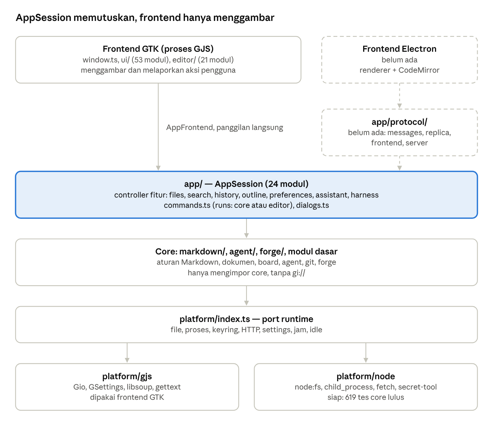
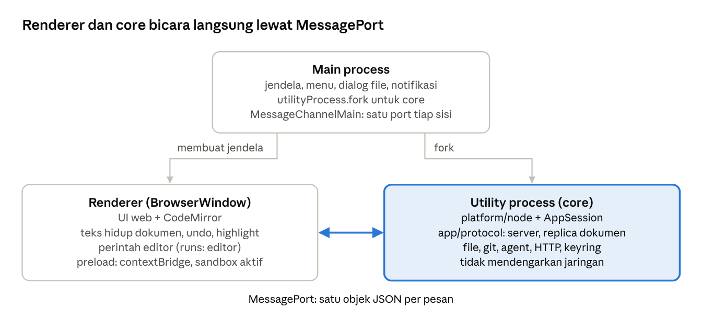
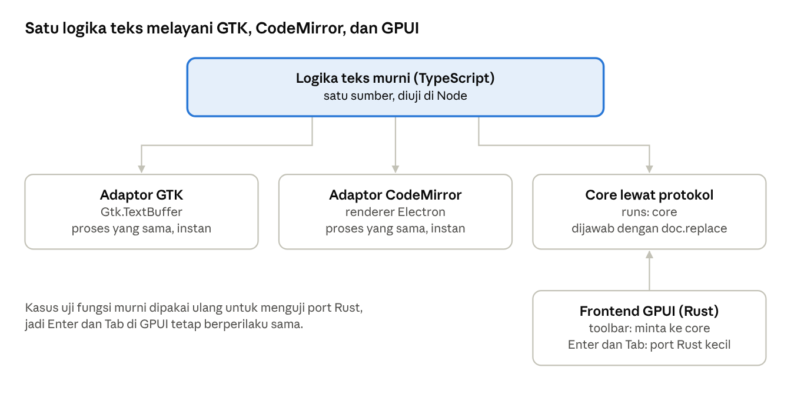
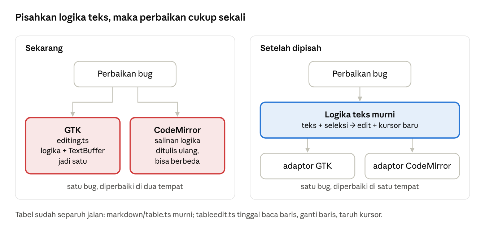

# Arsitektur Markwork dan jalan menuju Electron

17 Oktober 2026, diperbarui 18 Oktober 2026 · Eka Putra · salinan dari [doc Claude](https://claude.ai/code/artifact/86001ae8-365a-41e1-b0b5-cf4e07c2ef3b)

## Ringkasan

Fondasi untuk frontend kedua sudah selesai, tetapi protokol yang dibutuhkan Electron belum ditulis satu baris pun. Core sudah berjalan di Node (706 tes core lulus di Node v24), dan `AppSession` sudah memegang semua keputusan aplikasi. Antarmuka ke frontend juga sudah hanya menerima data biasa.

Sejak versi pertama dokumen ini, tiga celah core sudah ditutup: perintah editor (`markdown/editcommands.ts`), parser highlight (`markdown/highlight.ts`), dan port Node untuk macOS dan Windows (folder pengguna, `PATHEXT`, Trash, keyring, terminal). Sisanya ada di bagian [Status celah](#status-celah-diperbarui-18-oktober-2026).

Electron tidak memerlukan sidecar terpisah karena sudah membawa Node. Core cukup berjalan di *utility process* dan berbicara dengan renderer lewat `MessagePort`. Pekerjaan yang tersisa adalah lapisan `app/protocol/`, entry point untuk utility process, dan frontend web-nya sendiri, termasuk perintah editor untuk CodeMirror.

## Arsitektur saat ini

Codebase terdiri dari empat lapisan, dan setiap lapisan hanya bergantung pada lapisan di bawahnya. Frontend GTK memanggil `AppSession` langsung di prosesnya sendiri. Jalur untuk Electron sudah dirancang, tetapi belum ada kodenya.

Kotak yang disorot adalah tempat semua keputusan aplikasi. Kotak bergaris putus-putus adalah bagian yang belum dibuat.

| Lapisan | Folder | Tugas |
| --- | --- | --- |
| Frontend | `src/window.ts`, `src/ui/`, `src/editor/` | Widget GTK, editor GtkSourceView, highlight, perintah editor |
| Aplikasi | `src/app/` | `AppSession` dan controller fitur; memutuskan dokumen, simpan, board, agent, history |
| Core | `src/markdown/`, `src/agent/`, `src/forge/`, modul dasar | Aturan Markdown, agent dan aturan persetujuannya, git, forge, harness |
| Port runtime | `src/platform/index.ts` | Kontrak tunggal yang diisi oleh `platform/gjs` atau `platform/node` |

## Pengaman yang menjaga batas lapisan

Batas lapisan dijaga otomatis oleh pemeriksaan di build dan tes, bukan sekadar konvensi. Setiap daftar pengecualian sekarang kosong dan hanya boleh menyusut.

| Aturan | Dicek oleh | Pengecualian saat ini |
| --- | --- | --- |
| Core tidak mengimpor `gi://`, built-in GJS, `platform/gjs/`, atau `app/` | `scripts/layers.mjs` (`GI_ALLOWED`) | kosong |
| `app/` hanya mengimpor core dan `app/`, tanpa GTK | `scripts/layers.mjs` | — |
| View di `ui/` tidak mengimpor modul core yang menyentuh runtime | `scripts/layers.mjs` (`UI_ACTS_ALLOWED`) | kosong |
| Anggota `AppFrontend` dan `AppDialogs` hanya menerima dan mengembalikan data biasa | `tests/unit/plaindata.ts` (`KNOWN`), lewat `tsc` | kosong |
| Controller tidak membaca balik tulisannya sendiri sebelum tulisan itu sampai | `LaggingEditor` di `tests/unit/appsession.ts`, di GJS dan Node | — |
| Kontrak runtime sama di GJS dan Node | `tests/unit/platform.ts`, `npm run test:core:node` | — |

Aturan data biasa inilah yang membuat protokol nanti cukup menjadi penerjemah tipis. Setiap pemanggilan `AppFrontend` bisa langsung dibungkus menjadi satu pesan JSON.

## Bentuk proses aplikasi Electron

Core berjalan di *utility process* Electron, bukan di sidecar terpisah dan bukan di renderer. Main process hanya membuat jendela dan menghubungkan kedua sisi.

- **Bukan sidecar.** Electron sudah membawa Node, jadi `platform/node` jalan di dalamnya. Sidecar stdio (`src/sidecar.ts`) hanya untuk Tauri dan GPUI.
- **Bukan renderer.** Core butuh file, proses, dan keyring; membukanya di renderer berarti mematikan `contextIsolation`. Pekerjaan git dan agent juga akan berebut thread dengan ketikan.
- **Bukan main process.** Kalau core ikut di main, pekerjaan berat membuat menu dan jendela macet. Utility process yang crash tidak menutup jendela, dan teks yang belum disimpan tetap aman di renderer.
- **Editor tetap di renderer.** Ketikan tidak pernah menyeberang proses sebelum layar berubah. Core menerima perubahan sebagai `doc.edit` kecil setelahnya, dan menulis balik lewat `doc.replace` dengan versi dasar (bagian 5 [dokumen protokol](protocol.md)).

## Tahapan membuat aplikasi Electron

Urutannya: protokol diuji dulu tanpa UI, lalu satu irisan tipis dari ujung ke ujung, baru kemudian semua view. Tahap 1–3 mengikuti langkah 2–4 di [`docs/design/protocol.md`](protocol.md) bagian 15. Tahap 0 dan 4–7 khusus untuk Electron.

0. **Putuskan arah.**
   - `AGENT.md` mewajibkan GNOME HIG dan menolak tampilan bergaya web atau Electron. Aturan ini perlu ditulis ulang untuk frontend Electron, misalnya hanya berlaku bagi frontend GTK.
   - Pilih editor (CodeMirror 6 adalah kandidat yang disebut dokumen protokol) dan framework UI renderer.
   - Platform target: Linux, macOS, dan Windows. Di Linux, `secret-tool` cukup untuk keyring. Di macOS dan Windows port Node memberi jawaban "keyring tidak ada", sehingga kredensial memakai file konfigurasi; frontend Electron mengganti `Secrets` dengan `safeStorage`.
1. **Inti protokol, tanpa UI** (`src/app/protocol/`).
   - `messages.ts`: tipe semua pesan (request, reply, notice) sesuai bagian 4.2.
   - `replica.ts`: teks dan versi dokumen di core, `ProtocolEditor` yang mengimplementasikan `TextEditor`, termasuk `doc.edit`, `doc.replace` dengan `base`, dan `conflict`.
   - Tes fuzz replica dan skenario race dari bagian 10.2 dan 12.
   - `framing.ts` (baris JSON) tidak dibutuhkan Electron; cukup dibuat saat Tauri atau GPUI dimulai.
2. **Adapter frontend dan server.**
   - `frontend.ts`: `ProtocolFrontend` mengimplementasikan `AppFrontend` dengan mengirim notice dan ask.
   - `server.ts`: meneruskan request (perintah, aksi, jawaban) ke `AppSession`, termasuk `hello` dan `start` (bagian 4.5).
   - Fake frontend di Node menjalankan `AppSession` asli lewat protokol, di memori. Skenario yang sama juga dijalankan terhadap binding in-process GTK.
3. **Entry point core untuk Electron** (misalnya `src/electron/core.ts`).
   - Memasang `platform/node`, membuat `AppSession`, dan menyambungkan `server.ts` ke `MessagePort` (satu objek per post, tanpa framing baris).
   - Membundel teks schema GSettings untuk `JsonSettingsStore` dan menyertakan katalog `.mo` untuk `platform/node/i18n.ts`.
   - Dibangun lewat konfigurasi Vite untuk Node, seperti `vite.node.config.ts`.
   - Membuat `platform/node` jalan di macOS dan Windows. Sebagian besar sudah dikerjakan (`bf52388`, `Platform.os`); yang tersisa:
     - `Secrets`: di luar Linux port Node tidak punya keyring (jawaban "tidak ada"). Ganti dengan `safeStorage` milik Electron, diteruskan dari main process, atau keychain OS.
     - Jalur: `platform/node/dirs.ts` sudah memakai XDG di Linux, `~/Library` di macOS, dan `%APPDATA%`/`%LOCALAPPDATA%` di Windows. Electron boleh menimpanya dengan `app.getPath`.
     - Trash: `~/.Trash` di macOS dan Recycle Bin lewat PowerShell di Windows sudah ada, tetapi belum dijalankan di sistem itu. Boleh diganti dengan `shell.trashItem`.
     - Pencarian executable sudah memakai `PATHEXT` dan `%APPDATA%\npm` di Windows (`programNames`).
     - Audit path di core: `fileUri` dan pengecekan path absolut sudah sadar Windows (`2598a59`, `3fccae9`). Masih diaudit: sisa `startsWith('/')` dan `split('/')` (lihat tabel celah); perbandingan path yang tidak membedakan huruf besar-kecil di macOS dan Windows.
     - Jalankan `npm run test:core:node` di CI untuk ketiga OS. `tests/unit/crossos.ts` menguji bagian murni di sistem mana pun, tetapi Trash macOS, panggilan PowerShell, dan terminal belum dijalankan di sistem aslinya.
4. **Kerangka Electron.**
   - Main process: membuat `BrowserWindow`, menjalankan core dengan `utilityProcess.fork`, membuat `MessageChannelMain`, dan mengirim satu port ke core dan satu ke renderer.
   - Preload: menyerahkan port ke renderer lewat `contextBridge`, dengan `contextIsolation` aktif, `sandbox` aktif, dan `nodeIntegration` mati.
   - Layanan milik frontend (bagian 9.1): `open.uri` lewat `shell.openExternal`, notifikasi desktop, laporan `window.active`, dan dialog file yang menjawab `ask.file`.
   - Kalau core keluar: tampilkan potongan log stderr dan tawarkan restart. Teks yang belum disimpan aman di renderer.
5. **Irisan pertama dari ujung ke ujung.** Buka folder, buka dokumen board, pindahkan kartu, lihat teks berubah, lalu simpan.
   - Di irisan ini juga diukur pertanyaan terbuka bagian 16: undo dari dua sisi di CodeMirror, interval penggabungan edit 100 ms, dan seberapa ketat rebase.
6. **Editor di renderer.**
   - Konversi offset UTF-16 (CodeMirror) ke code point (protokol) di tepi editor.
   - Adaptor CodeMirror untuk perintah editor. Logika teksnya sudah murni di `markdown/editcommands.ts` dan adaptor GTK-nya di `editor/textedit.ts`; yang tersisa hanya adaptor CodeMirror.
   - Highlight Markdown: parser dan cache barisnya sudah di `markdown/highlight.ts` (generik terhadap gaya editor, diuji di GJS dan Node). CodeMirror cukup memberi gaya per nama sintaks (`Styles<T>`) dan menyambungkan baris editor lewat `TextLines`.
   - Popover `[[` dari cache jawaban `ask.notes`, dan menu milik view.
7. **Semua view dan ask, satu controller demi satu controller.**
   - Board, list, table, calendar, timeline, gallery, chart, tab CSV (`ui/csvpage.ts`, tabel yang bisa diedit), tab halaman HTML (`ui/htmlpage.ts`, kini di WebKitGTK dengan sandbox; di Electron pakai iframe `sandbox` atau `webview` dengan aturan yang sama: skrip tidak boleh membuka tautan atau memuat jaringan tanpa konfirmasi), Assistant dan log agent, history, search, outline, preferences.
   - Setiap view dicek perilakunya terhadap frontend GTK sebagai rujukan.
   - Setelah itu: packaging (electron-builder atau Forge), pembaruan otomatis, dan pengujian di Linux, macOS, dan Windows, termasuk tanda tangan kode di Windows serta notarisasi di macOS.

## Bagaimana dengan GPUI

GPUI adalah framework Rust, jadi frontend-nya tidak bisa memanggil logika teks TypeScript di proses yang sama. Core berjalan sebagai sidecar Node lewat stdio, dan di situlah `framing.ts` baru dibutuhkan. Untuk perintah editor ada tiga pilihan:

| Pilihan | Cara kerja | Kelebihan | Kekurangan |
| --- | --- | --- | --- |
| Tulis ulang di Rust | Logika perintah di-port ke frontend GPUI | Instan, tanpa proses lain | Salinan ketiga; masalah perintah ditulis dua kali makin parah |
| Jalankan di core | Perintah menjadi `runs: 'core'`: frontend mengirim perintah dan seleksi, core membalas `doc.replace` dengan versi dasar | Satu sumber logika; `conflict` di protokol sudah menangani balapan | Satu putaran bolak-balik lewat stdio |
| Sematkan mesin JS | Logika TS dijalankan di proses GPUI lewat QuickJS atau WASM | Satu sumber, tetap lokal | Rumit dan berat untuk keuntungan kecil |

Sarannya campuran, dibagi menurut apakah perintah itu terikat ke ketikan:

- **Perintah toolbar dan menu** (bold, link, heading, quote, operasi baris dan kolom tabel, perataan) dijalankan di core. Perintah ini dipicu klik, jadi jeda beberapa milidetik tidak terasa.
- **Perintah yang terikat ke tombol** (Enter yang melanjutkan list, Tab dan Enter di tabel) di-port ke Rust, hanya yang ini saja. Kalau perintah ini menunggu core, ketikan bisa tersendat; ini pelajaran dari Xi Editor.
- Highlight Markdown (misalnya dengan tree-sitter) dan konversi offset (byte UTF-8 di Rust, code point di protokol) juga ditulis di Rust.

Apa pun pilihannya, langkah pertamanya sama: memisahkan logika teks dari `Gtk.TextBuffer`. Setelah itu, memindahkan sebuah perintah ke core cukup dengan mengganti `runs`.

## Risiko dan pertanyaan terbuka

- **Perintah editor dan highlighter ditulis dua kali.** Risiko ini sudah dikurangi: logika teks perintah ada di `src/markdown/editcommands.ts` dan parser highlight di `src/markdown/highlight.ts`, keduanya murni; GTK memakai adaptor tipis (`editor/textedit.ts`, `editor/highlighter.ts`, 32 baris). Yang masih berpotensi ditulis dua kali adalah perilaku di atas adaptor: menyembunyikan sintaks di baris yang tidak aktif, lapisan kode, tabel, gambar, dan konflik (`editor/*layer.ts`).
- **Perilaku yang berbeda dari GTK.** Frontend GTK tetap menjadi rujukan. Tanpa skenario yang dijalankan di kedua sisi (bagian 12), perbedaan kecil seperti undo langkah kartu atau rebase yang ditolak akan lolos.
- **Keyring di macOS dan Windows.** `secret-tool` hanya dipakai di Linux. Di sistem lain port Node tidak punya keyring, jadi kunci API disimpan di file konfigurasi sampai frontend memasang `safeStorage` atau keychain OS. Jalur, Trash, dan pencarian executable sudah mengenal ketiga sistem (lihat tahap 3), tetapi bagian macOS dan Windows belum dijalankan di sistem aslinya.
- **Ukuran dokumen.** Seluruh teks dikirim saat `doc.open`. Untuk file beberapa MB ini masih wajar, tetapi perlu diukur di irisan pertama.
- **Satu jendela per core.** Beberapa jendela Electron butuh satu utility process per jendela, atau kepemilikan dokumen per jendela. Untuk versi awal, cukup satu jendela.
- **Kebijakan desain.** Selama `AGENT.md` mewajibkan GNOME HIG untuk semua antarmuka, frontend Electron bertentangan dengan aturan proyek sendiri. Ini harus diputuskan sebelum tahap 4.

Risiko pertama, perintah editor ditulis dua kali, terlihat seperti ini. Perintah seperti bold, link, heading, list, dan operasi tabel sekarang mencampur logika teks dengan `Gtk.TextBuffer`. CodeMirror tidak bisa memakai kode itu.

Kalau logikanya dipisah menjadi fungsi murni (teks dan seleksi masuk, edit dan posisi kursor keluar), GTK dan CodeMirror cukup menyediakan adaptor tipis. Fungsi murni itu bisa diuji di Node seperti core lainnya.

## Status celah (diperbarui 18 Oktober 2026)

Audit 17 Oktober 2026 menemukan sembilan celah di luar tahapan di atas. Berikut keadaannya menurut kode saat ini.

| Celah | Status | Keterangan |
| --- | --- | --- |
| Peluncuran terminal khusus GNOME ada di core | selesai | Daftar terminal (GNOME di Linux, Terminal di macOS, Windows Terminal lalu cmd di Windows) ada di `platform/terminals.ts`, dipakai kedua port lewat `platform().processes.openTerminal(folder, command)`. `app/harnessreview.ts` hanya memanggilnya. Frontend yang punya terminal sendiri (Electron, TUI) cukup menggantinya |
| `fileUri()` mengasumsikan path POSIX | selesai | `src/files.ts` menangani `C:\` dan `C:/` menjadi `file:///C:/…` (`2598a59`) |
| Pengecekan path absolut memakai `startsWith('/')` | selesai | Core memakai `platform().paths.isAbsolute` (`3fccae9`). Sisa `startsWith('/')` sengaja: path POSIX di mesin remote (`app/harness.ts`, `agent/worktree.ts`), nama dalam repo (`agent/changes.ts`, `forge/contribute.ts`), dan URL (`markdown/htmlview.ts`, `lint.ts`). `ui/gallery.ts` memakai `GLib.path_is_absolute`. `split('/')` yang tersisa memecah nama relatif dalam folder kerja, yang memang memakai `/`. Dokumen yang sedang dibuka kini dicari lewat `platform().paths.same(a, b)` (tidak membedakan huruf besar-kecil di macOS dan Windows, dan tidak peduli `.`/`..`), bukan `===`. `paths.relative` mengikuti `node:path`: tidak membedakan huruf di Windows, membedakan di macOS |
| Logika highlighter terikat GTK | selesai | Parser, re-parse inkremental, dan cache baris ada di `markdown/highlight.ts` (`04008b9`); `editor/highlighter.ts` tinggal adaptor `GtkTextBuffer`. Tes: `tests/unit/highlight.ts` di GJS dan Node |
| Rendering inline hanya ke Pango markup | selesai | `markdown/inlineruns.ts` memotong satu baris inline menjadi run teks dengan gaya yang sudah digabung; `pango.ts` dan `inlinehtml.ts` (HTML aman untuk `innerHTML`, kelas tanpa warna) hanyalah dua penyaji dari run yang sama. Jawaban asisten: `chatblocks.ts` memecah per baris, `chatmarkup.ts` dan `chathtml.ts` menyajikannya. Penyaji ANSI untuk TUI tinggal satu fungsi lagi di atas `inlineRuns`. Tes: `tests/unit/inlinehtml.ts` |
| Katalog `.mo` dan schema GSettings hanya dibangun meson | terbuka | `JsonSettingsStore` membaca schema (`data/com.ekaput.Markwork.gschema.xml`) lewat `platform/node/settings.ts`; yang belum ada hanyalah langkah build untuk membundelnya di Electron. `po/LINGUAS` masih kosong, jadi belum mendesak |
| `markworkd` hanya untuk Linux | terbuka | Di Go: `internal/server/peer.go` memakai `SO_PEERCRED` dan `syscall.Ucred` (Linux saja, build macOS gagal), `internal/runner` memakai `Setpgid`/`Kill(-pgid)`, `internal/daemonize` memakai `Setsid`/`Flock`, dan `config/paths.go` memakai XDG. macOS butuh file `peer_darwin.go` (`LOCAL_PEERCRED`) dan jalur sendiri; Windows butuh Job Object, pipe atau socket, dan kunci file lain, atau dijalankan tanpa daemon lokal (run berhenti saat aplikasi ditutup) dengan daemon di VPS atau WSL lewat SSH |
| Belum ada CI | terbuka | Tidak ada `.github/`. Syarat tahap 3: `npm run test:core:node` di Linux, macOS, dan Windows, ditambah `go vet`/`go build` dengan `GOOS=darwin` untuk daemon |
| Dependensi Electron belum ada | terbuka | `electron`, CodeMirror 6, framework UI renderer, dan electron-builder atau Forge |

Yang baru sejak audit dan relevan bagi Electron:

- **Tab CSV dan tab halaman HTML** (`ui/csvpage.ts`, `ui/htmlpage.ts`) menambah dua view yang perlu padanan di renderer (tahap 7). Model datanya sudah murni di `markdown/csv.ts`, `markdown/htmlview.ts`, dan `markdown/html.ts`.
- **Isolasi data per folder kerja** (`88dc3b5`): data aplikasi tiap folder kerja terpisah. Utility process yang melayani satu jendela dan satu folder cocok dengan model ini.

Urutan yang disarankan: CI tiga OS, lalu protokol tahap 1 (`messages.ts`, `replica.ts`, tes fuzz), lalu irisan board dari ujung ke ujung. Pekerjaan Electron tetap kontingensi sampai ada permintaan dari macOS atau Windows (lihat `AGENT.md`).
