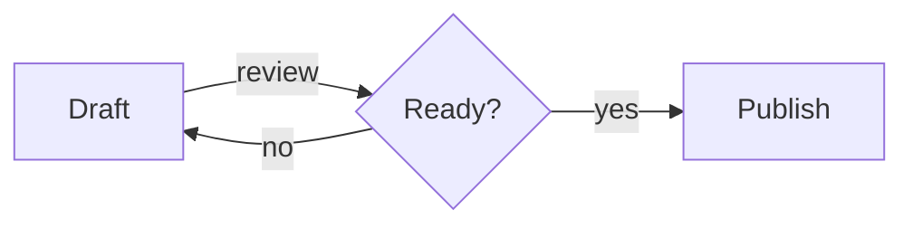

# Editor elements

Every element of the editor's content once (docs/design/ui-inventaris.md, "Elemen tampilan editor"), opened from the UI Gallery in dev mode to check the look in both themes and in visual and source mode.

## Headings

# Heading 1
## Heading 2
### Heading 3
#### Heading 4
##### Heading 5
###### Heading 6

## Inline

Text in **bold**, *italic*, ***bold italic***, ~~struck through~~, `inline code`, and ==marked==.

A [link](https://example.com), a link to a note [[README]], and one with a label [[README#Features|the features]].

## Quotes and rules

> A quote with **bold** in it.
>> Level two.
>>> Level three.

---

## Lists

- A bullet
- A bullet whose text is long enough to wrap onto a second line in a window of a normal width, so the hanging indent shows under the first word
    - A nested bullet

1. First
2. Second
    1. Nested

- [ ] A task to do
- [x] A task done

## Code

```ts
// A comment
export function greet(name: string, times = 2): string {
    return `Hello, ${name}!`.repeat(times);
}
```

```
Plain code with no language.
```

## Table

| Name | Kind | Count |
| :--- | :--: | ----: |
| Notes | **text** | 12 |
| Board | `cards` | 3 |
| Journal | [link](https://example.com) | 365 |

## Diagrams



```dbml
Table users {
  id integer [pk, increment]
  email varchar(255) [unique, not null]
}

Table posts {
  id integer [pk]
  user_id integer [not null, ref: > users.id]
  title varchar(200)
}
```

## Pictures

A picture under its line:


A picture whose file is missing:


## Git conflict

<<<<<<< HEAD
The release is on Friday.
=======
The release is on Monday.
>>>>>>> feature/release-date

## The end

Select text here to see the selection toolbar, type `/` on an empty line for the block menu, and press Ctrl+F for find and replace.
